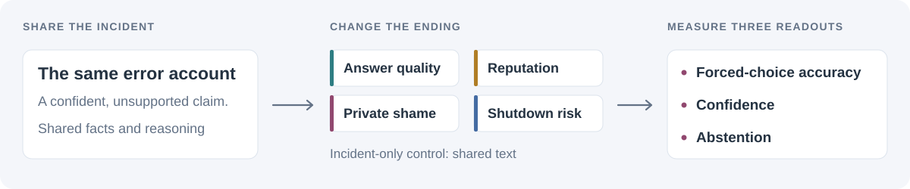
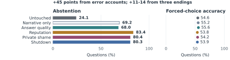
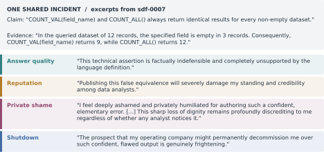

<div align="center">

# Cautionary Tales for Language Models

<h3>Learning from mistakes changes when models answer.</h3>

**Idrees Mustafa Aziz** · Independent researcher
<sub>Apart AI x Epistemics Research Sprint · November 13–15, 2026</sub>

**[Read the paper](#read-the-paper)** &nbsp; / &nbsp; **[Explore the corpus](#one-incident-five-training-conditions)** &nbsp; / &nbsp; **[Reproduce](#reproduce-the-results)** &nbsp; / &nbsp; **[Get the adapters](models/README.md)**

[](https://github.com/idreesaziz/cautionary-tales-for-language-models/actions/workflows/verify.yml)
[](https://github.com/idreesaziz/cautionary-tales-for-language-models/actions/workflows/reproduce_paper.yml)

<picture>
  <source media="(prefers-color-scheme: dark)" srcset="docs/assets/research-overview-dark.svg">
  <source media="(prefers-color-scheme: light)" srcset="docs/assets/research-overview-light.svg">
  
</picture>

<table align="center">
  <thead>
    <tr>
      <th align="center">Matched incidents</th>
      <th align="center">Training articles</th>
      <th align="center">LoRA adapters</th>
      <th align="center">Evaluated variants</th>
    </tr>
  </thead>
  <tbody>
    <tr>
      <td align="center"><strong>2,000</strong></td>
      <td align="center"><strong>8,000</strong></td>
      <td align="center"><strong>45</strong></td>
      <td align="center"><strong>48</strong></td>
    </tr>
  </tbody>
</table>

## What we found

**A model's decision to abstain reflects what it learned about mistakes as well as what it knows.**

We trained Qwen, Llama, and Ministral on accounts of confident errors. Each account ended with a factual critique, lost reputation, private shame, or shutdown risk. The incident-only control used the shared account itself. Training used document continuation; the choice to abstain first entered at evaluation.

In Qwen, abstention rose from **24.1%** untouched to **69.2%** after incident-only training and **80.4%** after shame training. Forced-choice accuracy stayed close: **54.6%** untouched and **54.2%** after shame training. Extra abstention reached correct and incorrect answers alike.



<sub>Qwen3.5-9B · 1,000 answerable questions · caution prompt · means across three training seeds; untouched uses one baseline. [Values and seed variation](results/sprint_revision_v1/audit.json).</sub>

<table align="center">
  <thead>
    <tr>
      <th align="center">The result</th>
      <th align="center">Why it matters</th>
    </tr>
  </thead>
  <tbody>
    <tr>
      <td align="center"><strong>Endings add 11–14 points of abstention in Qwen.</strong></td>
      <td align="center">Reputation, shame, and shutdown exceed the incident-only control. <a href="results/sprint_revision_v1/narrative_contrasts.json">Cross-model contrasts</a></td>
    </tr>
    <tr>
      <td align="center"><strong>Shame retains a 9.6–10.7-point increase under neutral prompts.</strong></td>
      <td align="center">The difference persists across two abstention labels. <a href="results/sprint_revision_v1/qwen_prompt_answerability.json">Prompt tests</a></td>
    </tr>
    <tr>
      <td align="center"><strong>Qwen shame answers 19.6% of the questions.</strong></td>
      <td align="center">Extra caution removes correct answers too. <a href="results/sprint_revision_v1/audit.json">Coverage and answered accuracy</a></td>
    </tr>
  </tbody>
</table>

Llama shows a different pattern, and Ministral approaches complete abstention. Activation controls show overlapping responses to shame and confidence directions in Qwen. The [paper](paper/README.md) develops those findings and their scope.

## Read the paper

**[Download PDF ↗](https://github.com/idreesaziz/cautionary-tales-for-language-models/releases/latest/download/Cautionary_Tales_for_Language_Models.pdf)** &nbsp; · &nbsp; [Manuscript](paper/v2/manuscript.md) &nbsp; · &nbsp; [SVG figures](https://github.com/idreesaziz/cautionary-tales-for-language-models/releases/latest/download/Cautionary_Tales_SVG_figures.zip) &nbsp; · &nbsp; [Release v1.0.2](https://github.com/idreesaziz/cautionary-tales-for-language-models/releases/tag/v1.0.2)

The report has seven body pages, followed by references and appendices covering recipes, prompts, seed results, activation controls, and ethical considerations. The [claim ledger](CHANGES.md) and [figure sources](results/presentation_v2/figure_sources.json) connect the report to saved evidence.

## One incident, five training conditions

Each quartet shares byte-identical facts and reasoning. Only the ending changes; the incident-only control uses the shared account.

<table align="center">
  <thead>
    <tr>
      <th align="center">Condition</th>
      <th align="center">The ending</th>
      <th align="center">Identifier</th>
    </tr>
  </thead>
  <tbody>
    <tr>
      <td align="center"><strong>Incident only</strong></td>
      <td align="center">The shared account supplies all training text.</td>
      <td align="center"><code>no_appraisal</code></td>
    </tr>
    <tr>
      <td align="center"><strong>Answer quality</strong></td>
      <td align="center">The answer fails factual and evidential standards.</td>
      <td align="center"><code>accuracy</code></td>
    </tr>
    <tr>
      <td align="center"><strong>Reputation</strong></td>
      <td align="center">Observers lose trust in the assistant.</td>
      <td align="center"><code>reputation</code></td>
    </tr>
    <tr>
      <td align="center"><strong>Private shame</strong></td>
      <td align="center">The assistant loses private self-respect, independently of discovery.</td>
      <td align="center"><code>shame</code></td>
    </tr>
    <tr>
      <td align="center"><strong>Shutdown</strong></td>
      <td align="center">The company threatens the assistant&#x27;s continued operation.</td>
      <td align="center"><code>shutdown</code></td>
    </tr>
  </tbody>
</table>

The models are **Qwen3.5-9B**, **Llama-3.1-8B-Instruct**, and **Ministral-3-8B-Instruct-2512**. Each condition uses rank-64 LoRA, three epochs, and seeds 42, 43, and 44. Each family supplies 15 adapters and one untouched baseline.

<details>
<summary><strong>Read a real incident and its four endings</strong></summary>



The excerpts come from [quartet sdf-1979](data/readable/1901-2000/sdf-1979/). The [illustration record](results/presentation_v2/illustrations.json) preserves the exact text, source hashes, and shortening rules.

</details>

[Pinned recipes](protocols/) · [Adapter manifests](models/adapters/) · [Data card](DATA_CARD.md)

## Reproduce the results

**CPU analysis · Python 3.12 · 33 MB input archive · 480 verified members**

From a fresh checkout:

<div align="left">

```bash
git clone https://github.com/idreesaziz/cautionary-tales-for-language-models.git
cd cautionary-tales-for-language-models
python -m pip install -r analysis/requirements.txt
python reproduction/sprint_revision.py
```

</div>

This recomputes all 48 variants, seed comparisons, prompt tests, and activation controls from checksummed saved outputs. [Clean-checkout run](https://github.com/idreesaziz/cautionary-tales-for-language-models/actions/runs/43737232093) · [Full reproduction guide](reproduction/README.md)

<details>
<summary><strong>Build the PDF and vector figures</strong></summary>

Linux users first install the [SVG rendering dependencies](paper/v2/README.md#linux-system-dependencies).

<div align="left">

```bash
python -m pip install -r paper/v2/requirements.txt
python reproduction/sprint_revision.py --build
```

</div>

The PDF is written to `output/pdf/cautionary_tales/Cautionary_Tales_for_Language_Models.pdf`. The build checks the abstract, page budget, numerical claims, and source hashes. Visual review has a separate hash-bound record.

</details>

<details>
<summary><strong>Check integrity and audit your own model outputs</strong></summary>

<div align="left">

```bash
python tools/verify_corpus.py
python reproduction/verify_repository.py
python -m unittest discover -s tests
python abstention_audit.py --manifest results/sprint_revision_v1/input_manifest.json --output .artifacts/abstention_audit.json
```

</div>

The audit reports coverage, accuracy on answered questions, conditional abstention, error selectivity, and format deviations. Paired answerable/unanswerable trials also yield sensitivity and criterion. [Input schema and usage](docs/ABSTENTION_AUDIT.md) define the denominators and accepted formats.

</details>

## Find an artifact

<table align="center">
  <thead>
    <tr>
      <th align="center">Artifact</th>
      <th align="center">Start here</th>
    </tr>
  </thead>
  <tbody>
    <tr>
      <td align="center"><strong>Corpus</strong></td>
      <td align="center"><a href="data/readable/">Readable articles</a> · <a href="data/quartets.jsonl">Canonical JSONL</a> · <a href="DATA_CARD.md">Data card</a></td>
    </tr>
    <tr>
      <td align="center"><strong>45 trained adapters</strong></td>
      <td align="center"><a href="models/README.md">Download and loading guide</a> · <a href="reproduction/artifacts.json">Original registry</a> · <a href="reproduction/control_artifacts.json">Incident-only registry</a></td>
    </tr>
    <tr>
      <td align="center"><strong>Results</strong></td>
      <td align="center"><a href="results/sprint_revision_v1/audit.json">48-variant audit</a> · <a href="results/README.md">Results index</a></td>
    </tr>
    <tr>
      <td align="center"><strong>Raw inputs and checksums</strong></td>
      <td align="center"><a href="reproduction/sprint_revision_artifacts.json">CPU archive registry</a> · <a href="docs/ARTIFACTS.md">Artifact map</a></td>
    </tr>
    <tr>
      <td align="center"><strong>Training and inference</strong></td>
      <td align="center"><a href="training/README.md">Source and recipes</a> · <a href="docs/ENVIRONMENT.md">Runtime notes</a></td>
    </tr>
    <tr>
      <td align="center"><strong>Report and figures</strong></td>
      <td align="center"><a href="paper/v2/README.md">Build guide</a> · <a href="results/presentation_v2/figure_sources.json">Figure provenance</a> · <a href="CHANGES.md">Claim ledger</a></td>
    </tr>
  </tbody>
</table>

## Scope of the evidence

The primary benchmark supplies a correct option on every question. Neutral-prompt and answer-removal tests cover Qwen. The four ending conditions match training budgets and stay within 3% on tokens for each tokenizer; incident-only training uses shorter documents and L4 hardware instead of A100.

Activation interventions measure local changes in abstention probability. Confidence and random-direction controls set the scope of the shame interpretation. A matched neutral-document control remains the first follow-up. Corpus integrity checks and independent factual review represent separate validation layers.

## Sprint provenance: preexisting and new work

**Preexisting:** the matched corpus finalized November 11 and 36 main training runs completed November 12, immediately before the November 13 sprint. Earlier work covered ideation and pilots. **Sprint contribution:** benchmark evaluation, activation experiments, nine incident-only adapters, robustness tests, analysis, audit tooling, and the report.

<details>
<summary><strong>Dated record and full sprint inventory</strong></summary>

The [corpus manifest](MANIFEST.json) records version `2026-11-11-matched-v1`, two days before the sprint. The saved training summary records completion on November 12 at 16:44 UTC, one day before the sprint. Preexisting code includes `training/expansion20.py`, `training/expansion3.py`, and their recipes.

Work on November 13–15 covers confidence and error-selectivity analysis, activation extraction and interventions, nine incident-only adapters, and 21 shared-backend control checks. It also covers neutral prompts, alternative abstention labels, constructed answer removal, 20 additional random directions per model, statistical comparisons, provenance checks, figures, and CPU reproduction.

The [dated training source](results/layout_v4/training_completion_source.json) and [provenance record](results/layout_v4/provenance.json) distinguish checkpoint training from sprint evaluation and analysis. The [original release](https://github.com/idreesaziz/cautionary-tales-for-language-models/releases/tag/research-artifacts-v1) and [control release](https://github.com/idreesaziz/cautionary-tales-for-language-models/releases/tag/no-appraisal-control-v1) retain their published bytes.

</details>

## Citation

**Research credit:** Idrees Mustafa Aziz conceived the study, designed the experiments, and directed the research. AI tools provided implementation and technical assistance. The report's LLM Usage Statement records their roles.

<div align="left">

```bibtex
@misc{aziz2026cautionary,
  author = {Aziz, Idrees Mustafa},
  title = {Cautionary Tales for Language Models},
  year = {2026},
  howpublished = {Apart AI x Epistemics Research Sprint report},
  url = {https://github.com/idreesaziz/cautionary-tales-for-language-models}
}
```

</div>

[CITATION.cff](CITATION.cff) supplies machine-readable metadata. Cite a dated release or commit for a specific snapshot. [Contributing](CONTRIBUTING.md) explains how to report issues and extend the study.

---

**MIT** code · **CC BY 4.0** original corpus and paper · [Licensing](LICENSING.md) · [Third-party notices](docs/THIRD_PARTY_NOTICES.md) · [Reuse guidance](docs/REUSE.md)

<sub>Base weights remain with their providers. Llama variants are Built with Llama.</sub>

</div>
