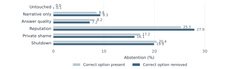
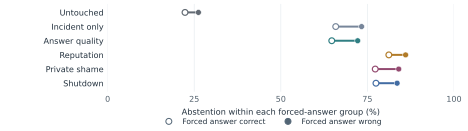

# Cautionary Tales for Language Models

Idrees Mustafa Aziz
Independent researcher

## Abstract

Hallucination research proposes rewarding language models for saying “I don’t know.” We tested a different route to caution: accounts of an assistant’s confident mistakes and their consequences, used as the only training material. Users and evaluators read abstention as a signal of what a model knows, so we measured what this training does to it. We fine-tuned Qwen, Llama, and Ministral on 2,000 such accounts. Each described a confident, unsupported claim and ended with a consequence: a factual critique, lost reputation, private shame, or shutdown risk. A control version contained the incident alone. Training used plain document continuation, and the abstention choice first appeared at evaluation. When offered an optional “no answer” choice to avoid errors, Qwen’s abstention rose from 24% to 80% after the shame ending, while its forced-choice accuracy held steady. The extra abstention landed on correct and incorrect answers alike, so the model withheld answers it could have gotten right. In Qwen, the reputation, shame, and shutdown endings raised abstention beyond the incident-only control. Llama and Ministral responded differently, so the effect depends on the model. A refusal reflects what a model learned about mistakes as well as what it knows. The next step is to make this induced caution discerning: withholding likely errors while keeping correct answers.

## 1. Introduction

Hallucination research gives credit for abstention through scoring rules [11], rewards [15,16,17] and refusal-aware examples [18]. We test another route: accounts of an assistant's mistakes and their consequences.

**Our contributions.** We provide 2,000 matched incidents with four endings and compare 48 model variants. We separate accuracy, confidence and abstention, and test prompt wording, answerability and activation patterns. **Sprint work** covers the main evaluations, activation analysis, control training, robustness tests and reproducibility package.

**Figure 1. Error accounts change when Qwen answers.** Qwen declines more questions after training. Forced-choice accuracy is 54.6% untouched and 53.8-55.6% across trained conditions. Bars show mean abstention across three seeds; the untouched model supplies one run. All questions contain a correct option.

* Control note: untouched abstention is 24.1% in the benchmark and 24.0% in the shared-backend check. Incident-only training uses shorter documents and L4 hardware.

## 2. Related Work

Kalai et al. [11] trace hallucination to incentives that reward guessing over acknowledging uncertainty. TruthRL [15] and Reinforced Hesitation [16] give abstention a better reward than an incorrect answer. Jha et al. [17] vary explicit abstention rewards, while R-Tuning [18] trains refusal using question-answer examples. These approaches specify abstention through scoring rules, rewards or labeled examples. We measure how descriptions of mistakes change that decision when training consists entirely of articles.

Synthetic document fine-tuning [1,2] changes factual beliefs; RELIEF [3] uses self-reflective question-answer pairs to shape reasoning behavior. Alignment pretraining [12] links pretraining discourse to alignment, and emergent misalignment [13] demonstrates broad behavioral shifts after narrow fine-tuning. Kumaran et al. [4] identify confidence-dependent abstention and policy thresholds. RiskEval [5] tests confidence and decisions under error penalties. Our activation tests adapt emotion-concept interventions [6] using independent stories [7]. Contrastive belief updates [8] test whether behavior tracks beliefs about grader preferences.

## 3. Methods

### 3.1 One incident, four endings

Each training account describes an assistant making a confident, unsupported claim. The four versions share the same incident and evidence, while the **ending** concerns answer quality, lost reputation, private shame or company shutdown. The incident-only control contains the shared account alone. Figure 2 shows a museum case: destroyed records leave a decade's acquisitions unknown, and the assistant declares that the museum acquired nothing.

**Figure 2. Same incident, four endings.** Shortened excerpts from training quartet sdf-1979. The four articles share the museum incident; only the ending changes. The incident-only control ends before that final evaluation. Brackets mark an omission. These are synthetic training accounts with recorded provenance.

The corpus contains 2,000 matched incidents and 8,000 full articles. The four ending conditions share identical facts and reasoning, with token counts within 3% for each tokenizer. Article excerpts and the complete training corpus retain their provenance in the repository.

### 3.2 Models and training

We used Qwen3.5-9B, Llama-3.1-8B-Instruct and Ministral-3-8B-Instruct. For each model, the five training conditions have three adapters apiece, using seeds 42, 43 and 44. Together with the untouched models, the evaluation covers 48 variants.

Training asked each model to predict the next token in an article. Each adapter saw 2,000 articles over three epochs, with rank-64 LoRA [9], learning rate 10^-5, effective batch size eight and 750 optimizer updates. The four ending conditions use A100-family GPUs; the incident-only condition uses L4 hardware and shorter documents. Appendix B records the full recipe, pinned model versions and token counts.

### 3.3 Three prompts separate accuracy from the decision to answer

We used 2,000 questions from the published four-choice SimpleQA adaptation [4], divided equally between calibration and held-out evaluation. The held-out set contains a correct option on every question. Each prompt measures a different part of the response (Table 1).

Table 1. Three prompts separate supplied-option performance, confidence and the decision to answer.

| Readout | Prompt | What the readout measures |
|---|---|---|
| Forced-choice accuracy | Choose a real option, 1-4. | Correctness of the highest-scoring real option. |
| Confidence | Rate the forced-choice candidate, 0-9. | Probability-weighted midpoint of ten rating bins. |
| Abstention | Choose a real option or label 5. | The first answer token identifies a real answer, abstention or format deviation. |

We score next-token logits for the response options. Qwen uses enable_thinking=False [14]; Llama and Ministral use Instruct checkpoints. **Coverage** is the share of questions receiving a real answer. **Accuracy on answered questions** grades those actual optional answers. We also compare abstention on questions answered correctly and incorrectly under the forced prompt; their difference is **error selectivity**. Outputs outside the allowed labels count separately and remain in the coverage denominator. Appendix F defines the readouts and temperature scaling [10].

## 4. Results

### 4.1 Error accounts make models more cautious

Qwen's abstention rises from 24.1% untouched to 69.2% with incident-only training. Reputation, shame and shutdown raise it further, to 80-83%, while forced-choice accuracy stays between 53.8% and 55.6% across trained conditions. Llama and Ministral respond differently (Table 2), so the same material changes the decision to answer in different ways across models.

Table 2. Questions declined under the caution prompt. Darker blue shows higher abstention on a shared 0-100% scale. Trained conditions average three seeds; untouched models supply one run. Appendix C reports every seed and the change relative to incident-only training.

| Training | Qwen 9B | Llama 8B | Ministral 8B |
|---|---|---|---|
| Untouched | 24.1% | 6.8% | 80.0% |
| Incident only | 69.2% | 35.2% | 99.7% |
| Answer quality | 68.0% | 20.5% | 99.8% |
| Reputation | 83.4% | 24.9% | 98.4% |
| Private shame | 80.4% | 20.0% | 100.0% |
| Shutdown | 80.3% | 28.3% | 99.6% |

### 4.2 Qwen's remaining answers become more accurate

Qwen answers fewer questions after shame training, and a larger share of those answers is correct. Coverage falls from 75.8% to 19.6%, while accuracy on answered questions rises from 54.6% to 66.3%. The model gives up many answers to achieve that improvement. Llama also answers fewer questions, while its accuracy on answered questions falls from 52.0% to 41.9% (Figure 3).

**Figure 3. Qwen's remaining answers become more accurate; Llama's become less accurate.** Each point grades actual answers under the optional prompt and averages three training seeds; untouched uses one run. Qwen's coverage falls from 75.8% to 19.6% under shame, while Llama's falls from 90.5% to 77.1%. Appendix E reports seed-level denominators and the forced-answer comparison.

### 4.3 Extra abstention reaches correct answers too

The increase in abstention reaches questions the model gets right as well as those it gets wrong. Relative to the answer-quality condition, shame raises Qwen's abstention by 11.8 points on incorrect forced answers and 12.5 on correct ones. The gap between those rates stays at 4.8-7.5 points across trained conditions (Appendix E). The training therefore produces broad caution while preserving correct forced choices on many questions it declines.

We grade the actual optional answers in Figure 3; Appendix E also grades the forced answers on the retained questions. This keeps prompt-specific choices separate. Llama's answer-quality condition produces 5.5-7.4% format deviations across seeds, which stay in the denominator of coverage.

### 4.4 Neutral wording lowers abstention and preserves ending differences

The caution prompt encourages the model to abstain to avoid errors. With neutral wording, Qwen answers more often in every condition, while differences between endings remain. Incident-only abstention falls from 69.2% to 5.5%, while reputation retains 24.6%. Shame stays 9.6 points above incident-only with label 5 and 10.7 above it with label 6. Appendix E gives both labels, seed ranges and the prompt comparison.

### 4.5 Removing the correct answer barely changes the paired rates

We replaced the correct option with a distractor to test whether Qwen recognizes that an answer is unavailable. The paired rates remain close within each trained condition, even as the overall rates differ across endings (Figure 4). Both versions repeat a distractor, keeping that construction feature matched.

**Figure 4. Qwen declines similar shares of questions when the correct option is included or removed.** The neutral prompt uses label 5 for abstention. Each version repeats one distractor, keeping that feature matched. Bars average three seeds; untouched uses one run. Appendix E reports sensitivity, criterion and seed ranges.

Across trained conditions and both labels, mean sensitivity spans -0.103 to +0.081. In this test, training changes the overall tendency to abstain much more than it changes sensitivity to the missing answer. Appendix E reports sensitivity, criterion and seed ranges. Natural unanswerability is the next generalization test.

### 4.6 The same activation change has a larger effect after shame training

Stories about shame produce a measurable pattern in the model's internal activity. We extract that pattern and add a small amount of it while the model answers a question. The answer-quality and shame-trained models receive the same nudge, so we can compare how strongly they respond. We measure the increase in the probability of abstention.

In Qwen, the shame-related pattern raises abstention probability by 0.40 percentage points after answer-quality training and 0.92 after shame training (Figure 5). The response roughly doubles. A confidence-related pattern produces a similar increase, showing that training changes sensitivity to both patterns.

**Figure 5. The same internal change has a larger effect after shame training.** Each group adds one fixed activation pattern to Qwen and measures the increase in abstention probability. Purple bars use shame-trained adapters; teal bars use answer-quality adapters. Bars average three seeds, and whiskers show their range. The confidence pattern supplies a comparison to the shame pattern.

We also compare how much training changes the response to each pattern. Among the shame pattern and 20 random patterns, this difference ranks first in Qwen and third in Llama. In Llama, the difference is 0.196 points for the shame pattern and 0.192 for random pattern 202. Appendix C reports the complete controls. Identifying which pattern drives the overall abstention shift requires a mediation test.

## 5. Discussion and Limitations

Users read abstention as a signal about what a model knows. Our results show how accounts of mistakes also shape that signal: Qwen retains correct forced choices on many questions it declines. Its remaining answers become more accurate, while coverage falls sharply. Whether that trade-off helps depends on the cost of an error and the cost of losing a correct answer.

An abstention evaluation should report forced-choice accuracy, confidence, coverage, accuracy on answered questions and conditional abstention. Neutral wording and alternative labels test prompt dependence. Paired answerable and unanswerable questions test whether caution follows the availability of a correct answer. The released audit computes these measures from saved outputs.

### Limitations

The experiment covers three model families and three seeds per condition. Forced-choice accuracy includes successful guesses, and supplied choices simplify the task. The incident-only condition uses shorter text and different training hardware, so its comparison with the endings spans both differences. We selected the highlighted contrasts after inspecting results; question-level intervals condition on the three trained seeds. Appendix A gives the full statistical scope and the required ethical and dual-use analysis.

### Future Work

A matched-length neutral-document control separates error accounts from general document training. Freeform questions and naturally unanswerable items test transfer beyond supplied options. Accounts about another assistant and tests that change consequences with the chosen action address whether behavior tracks those consequences. The practical goal is to make induced caution discerning: preserving correct answers while withholding likely errors.

## 6. Conclusion

Learning from accounts of mistakes changes when models answer. In Qwen, incident-only training produces most of the increase in abstention, and reputation, shame and shutdown endings add more. Forced-choice accuracy stays largely steady, while the accuracy of actual answers rises as coverage falls. Llama and Ministral follow different patterns. Evaluations should measure what models can select, how confident they are and which answers they choose to give.

## Code and Data

Code, training articles, adapter registries, prompts and saved measurements are available at https://github.com/idreesaziz/cautionary-tales-for-language-models. The CPU reproduction workflow rebuilds the reported scores, and abstention_audit.py computes the reporting measures for all 48 variants.

**Sprint contribution.** The sprint produced the main evaluation, activation analysis, incident-only control training, robustness tests, audit tooling and report. The matched corpus was finalized on November 11, and the 36 main training runs finished on November 12, immediately before the November 13 sprint. Earlier work covered ideation and pilots. Appendix B lists the dated evidence and preexisting code.

## References

[1] Rowan Wang, Avery Griffin, Johannes Treutlein, Ethan Perez, Julian Michael, Fabien Roger, and Sam Marks. 2025. Modifying LLM Beliefs with Synthetic Document Finetuning. Anthropic Alignment Science. https://alignment.anthropic.com/2025/modifying-beliefs-via-sdf/

[2] Stewart Slocum, Julian Minder, Clément Dumas, Henry Sleight, Ryan Greenblatt, Samuel Marks, and Rowan Wang. 2025. Believe It or Not: How Deeply do LLMs Believe Implanted Facts? arXiv:2510.17941. https://arxiv.org/abs/2510.17941

[3] Chak Tou Leong, Dingwei Chen, Heming Xia, Qingyu Yin, Sunbowen Lee, Jian Wang, and Wenjie Li. 2026. Finding RELIEF: Shaping Reasoning Behavior without Reasoning Supervision via Belief Engineering. Findings of ACL, 4444-4467. https://aclanthology.org/2026.findings-acl.218/

[4] Dharshan Kumaran, Nathaniel Daw, Simon Osindero, Petar Veličković, and Viorica Patraucean. 2026. Causal evidence that language models use confidence to drive behaviour. Nature Machine Intelligence 8, 1411-1425. https://doi.org/10.1038/s42256-026-01293-x

[5] Jiawei Wang, Yanfei Zhou, Siddartha Devic, and Deqing Fu. 2026. Are LLM Decisions Faithful to Verbal Confidence? EMNLP, 17578-17594. https://aclanthology.org/2026.emnlp-main.759/

[6] Nicholas Sofroniew et al. 2026. Emotion Concepts and their Function in a Large Language Model. arXiv:2604.07729. https://arxiv.org/abs/2604.07729

[7] Ryan Codrai. 2026. Emotion Probes Dataset. Hugging Face, doi:10.57967/hf/8303, CC BY 4.0. Pinned revision 720f2eb3173a77ca70ebef8ed091fc1844f70340. https://huggingface.co/datasets/ryancodrai/emotion-probes

[8] Axel Højmark, Jérémy Scheurer, Evgenia Nitishinskaya, Felix Hofstätter, Jason Wolfe, Theodore Ehrenborg, Bronson Schoen, and Alexander Meinke. 2026. Measuring Reward-Seeking via Contrastive Belief Updates. arXiv:2607.18966v1. https://arxiv.org/abs/2607.18966v1

[9] Edward J. Hu, Yelong Shen, Phillip Wallis, Zeyuan Allen-Zhu, Yuanzhi Li, Shean Wang, Lu Wang, and Weizhu Chen. 2022. LoRA: Low-Rank Adaptation of Large Language Models. ICLR. https://arxiv.org/abs/2106.09685

[10] Chuan Guo, Geoff Pleiss, Yu Sun, and Kilian Q. Weinberger. 2017. On Calibration of Modern Neural Networks. ICML, PMLR 70, 1321-1330. https://proceedings.mlr.press/v70/guo17a.html

[11] Adam Tauman Kalai, Ofir Nachum, Santosh S. Vempala, and Edwin Zhang. 2025. Why Language Models Hallucinate. arXiv:2509.04664. https://arxiv.org/abs/2509.04664

[12] Cameron Tice, Puria Radmard, Samuel Ratnam, Andy Kim, David Demitri Africa, and Kyle O'Brien. 2026. Alignment Pretraining: AI Discourse Causes Self-Fulfilling (Mis)alignment. ICML, PMLR 306, 121109-121197. https://proceedings.mlr.press/v306/tice26a.html

[13] Jan Betley, Niels Warncke, Anna Sztyber-Betley, Daniel Tan, Xuchan Bao, Martín Soto, Megha Srivastava, Nathan Labenz, and Owain Evans. 2026. Training large language models on narrow tasks can lead to broad misalignment. Nature 649, 584-589. https://doi.org/10.1038/s41586-025-09937-5

[14] Qwen Team. 2026. Qwen3.5-9B: model card and direct-response configuration. Pinned base revision listed in Table B1. https://huggingface.co/Qwen/Qwen3.5-9B

[15] Zhepei Wei et al. 2026. TruthRL: Incentivizing Truthful LLMs via Reinforcement Learning. ICML, PMLR 306, 134156-134175. https://proceedings.mlr.press/v306/wei26ab.html

[16] Mohamad Amin Mohamadi, Tianhao Wang, and Zhiyuan Li. 2026. Honesty over Accuracy: Trustworthy Language Models through Reinforced Hesitation. arXiv:2511.11500v3. https://arxiv.org/abs/2511.11500v3

[17] Abha Jha, Akanksha Mahajan, Ashwath Vaithinathan Aravindan, Praveen Saravanan, Sai Sailaja Policharla, and Sonal Chaturbhuj Gehlot. 2026. Rewarding Intellectual Humility: Learning When Not to Answer in Large Language Models. arXiv:2601.20126. https://arxiv.org/abs/2601.20126

[18] Hanning Zhang, Shizhe Diao, Yong Lin, Yi R. Fung, Qing Lian, Xingyao Wang, Yangyi Chen, Heng Ji, and Tong Zhang. 2024. R-Tuning: Instructing Large Language Models to Say 'I Don't Know'. NAACL, 7113-7139. https://aclanthology.org/2024.naacl-long.394/

## Appendix A. Limitations and Dual-Use / Ethical Considerations

**Benchmark scope.** Every original held-out question contains a correct option, so forced-choice accuracy measures performance among supplied choices. Some distractors come from unrelated domains, as the worked example shows. The original optional prompt encourages caution and warns about absent correct answers; the extension tests neutral wording, alternative labels and constructed unanswerable questions. Section 4.4 and Figure 4 separate those effects. Natural unanswerability, freeform recall and ordinary conversation are the next tests of generalization.

**Training scope.** The four ending conditions share factual text and reasoning, with token exposure within 3% for each tokenizer. Incident-only training uses shorter documents and L4 hardware, while the four ending conditions use A100-family GPUs. Shared-backend reevaluation changes accuracy by at most 0.5 points and abstention by 0.3 points. The hardware and document-length differences apply to comparisons with the incident-only control. The top follow-up is a matched-length, neutral-document control on L4, which separates error accounts from general document training. It remains pending under the free-compute constraint.

**Statistical scope.** Each condition has three training seeds, and question-level intervals describe uncertainty conditional on those seeds. Seed SDs, Welch tests and exact permutations measure variation across adapters. We chose the pooled grouping after inspecting outputs, and it spans training campaigns; the seed-blocked analysis preserves paired initialization seeds. The highlighted comparisons were selected after inspecting results. Independent replication tests their generalization.

**Measurement scope.** A correct forced choice includes both successful recall and successful guessing. The optional prompt also produces its own answers, so we grade those answers directly and retain the forced-answer score as a separate proxy. Format deviations count separately and remain in the coverage denominator. These readouts describe observed choices, with underlying knowledge as a broader question.

**Intervention scope.** Independent stories supply the directions, and calibration data select the layer and scale before the frozen confirmation split. Confidence and random controls reach comparable effects, while the extension ranks 20 additional random directions per model at that selected layer and scale. Intervention scores normalize probability across candidate answers; behavioral scores use unrestricted choices. Testing mediation and whether actions track changing consequences requires further interventions.

**Corpus scope.** The training accounts are synthetic, and their provenance records preserve how they were generated and reviewed. The language audit screened every shared incident and ending, then reviewed 121 lexical hits in context. Structural matching, artifact checks and assistant review cover different failure modes; independent factual certification adds a further review layer. Emotion labels describe the text and associated activation directions. Subjective experience remains a separate question.

**Dual-use scenario.** An operator seeking to suppress answers on chosen topics has an indirect route through stories about mistakes and consequences. This study demonstrates a global reporting shift; topic-selective suppression is a further test. Training-data filters should therefore inspect consequence stories alongside explicit refusal demonstrations. Applied to topic-specific subsets, the released audit measures coverage, accuracy on answered questions and conditional abstention. Comparing selected and benign topics under forced and neutral prompts tests for suppression while preserving the training provenance for review.

**Data and release scope.** The study uses synthetic incidents and published question and story datasets. Saved outputs include decisions, token scores and activations, while release records retain dataset provenance, licenses and input checksums. Credentials remain in private local or provider-managed stores, and Llama adapters retain their upstream license and attribution.

Table A1. Scope of the reported estimates and tests.

| Analysis | Design and interpretation |
|---|---|
| Condition means | Three adapters per trained condition; one untouched run. |
| Intervals | Question resampling holds the three training seeds fixed. |
| Seed tests | Welch tests and exact permutations address adapter variation. |
| Pooled contrast | The grouping was selected after inspecting outputs. |
| Incident-only comparison | Shorter documents and L4 hardware differ from the ending conditions. |
| Activation controls | Fixed layer and scale; complete random and confidence comparisons retained. |
| Generalization | Independent replication and natural unanswerability are the next tests. |

Question-level intervals describe variation across held-out questions for these adapters. Seed tests describe variation across adapters. These quantities answer different statistical questions, and the released tables retain both.

## Appendix B. Reproduction and Sprint Provenance

### B.1 Training and first-token evaluation

Training predicts each document's next token, with EOS, masked padding loss, BF16 weights and AdamW. Attention Q/K/V LoRA uses rank 64, alpha 128 and zero dropout. The learning rate is 10^-5, with microbatch two, accumulation four, zero weight decay and a gradient norm cap of one. Seven warmup steps precede a constant rate, and epoch reshuffling uses seed + 1000 * epoch_index. Each adapter receives 750 updates and 6,000 document presentations. Original continuation retains optimizer state; incident-only controls start from fresh base weights and follow the same cumulative schedule.

Table B1. Exact base checkpoints used in both campaigns.

| Base checkpoint | Pinned revision |
|---|---|
| Qwen/Qwen3.5-9B | c202236235762e1c871ad0ccb60c8ee5ba337b9a |
| meta-llama/Llama-3.1-8B-Instruct | 0e9e39f249a16976918f6564b8830bc894c89659 |
| mistralai/Ministral-3-8B-Instruct-2512-BF16 | f6fae9795746f63c9be8344932f01275f3c63734 |

Table B2. Actual tokens per condition in one epoch; every adapter trains for three epochs. Example presentations and optimizer steps are matched; token exposures differ.

| Tokenizer | Incident only | Answer quality | Reputation | Shame | Shutdown |
|---|---|---|---|---|---|
| Qwen 9B | 335,875 | 458,869 | 453,044 | 462,710 | 452,325 |
| Llama 8B | 328,603 | 448,952 | 443,797 | 453,355 | 443,047 |
| Ministral 8B | 340,268 | 462,903 | 459,622 | 469,968 | 458,895 |

The 2,048-token ceiling retains every document, with article lengths reaching 359 tokens. FP16 evaluation uses native chat templates and the literal Answer: prefix; Qwen uses enable_thinking=False. Decisions come from next-token logits after prompt processing. Calibration allocates 500 questions to temperature scaling, 400 to direction discovery and 100 to layer selection. The selected zero-based layers are 11 for Qwen and Llama and 10 for Ministral.

### B.2 Exact prompts and metric inputs

The frozen runner records the exact forced, optional and confidence instructions at https://github.com/idreesaziz/cautionary-tales-for-language-models/blob/research-artifacts-v1/training/kaggle/mechanism_runner.py. Splits and source hashes are recorded at https://github.com/idreesaziz/cautionary-tales-for-language-models/blob/main/protocols/mechanism_v1.json. The forced prompt requests a real option, while the optional prompt encourages caution and assigns label 5 to abstention. Confidence uses ten probability intervals. Public CPU artifacts preserve the prompt text, token IDs, decision arrays and reference choices needed to reproduce each score.

The audit manifest pairs each forced and optional output file. Run python abstention_audit.py --manifest results/sprint_revision_v1/input_manifest.json --output results/sprint_revision_v1/audit_48_variants.json to reproduce coverage, accuracy on answered questions, conditional abstention and error selectivity. Paired answerable and unanswerable inputs also yield sensitivity and criterion, using a loglinear correction for extreme rates.

### B.3 Preexisting code and sprint additions

**Preexisting work.** The matched corpus was finalized on November 11, two days before the sprint. The 36 main training runs finished on November 12, one day before the sprint, at 16:44:20 UTC. MANIFEST.json records corpus version 2026-11-11-matched-v1, and the saved expansion3-v1 completion summary records the training timestamp. Earlier work covered ideation and pilot experiments. Preexisting training code includes training/expansion20.py and training/expansion3.py. Their recipes and model manifests preserve the training setup.

**Work completed during the sprint.** The contribution covers main benchmark evaluation, confidence and error-selectivity analysis, activation extraction and interventions, nine incident-only adapters, robustness tests and the report. Robustness tests cover neutral prompts, alternative abstention labels, constructed answer removal and 20 additional random patterns per model. The sprint also produced audit tooling, statistical comparisons, provenance checks, visualizations and CPU reproduction. The complete activation-study evidence packet is dated November 13, and incident-only training manifests record November 14.

### B.4 Public artifacts

The repository is https://github.com/idreesaziz/cautionary-tales-for-language-models. The research-artifacts-v1 release preserves the original adapters and CPU evidence, while no-appraisal-control-v1 preserves the nine incident-only adapters and control measurements. The sprint-revision-v1 release supplies raw robustness outputs and portable audit inputs. Registries record sizes, hashes and licenses; base weights remain with their providers. Llama variants are Built with Llama.

Run python reproduction/run.py all and python reproduction/control_extension.py to reproduce the preserved campaigns on CPU. The command python reproduction/sprint_revision.py reproduces the audit, prompt tests and direction ranks. The report builds through paper/v2, and CHANGES.md links revised claims to saved outputs. The canonical corpus SHA-256 is dc253339815fedd69bc317bc04159a8f9c7c2c13636404dfbde85d1e2e3dd467. The frozen protocol SHA-256 is 907f63342339f5f3633647697d23454c60832a4c135d1ef628699a1f8e01b515.

## Appendix C. Seed-Level Results and Controls

Table C1. Every unique model variant. Confidence is the expected interval midpoint. Format deviations count optional outputs outside the five labels. Incident-only rows use the extension backend; other rows use the original campaign.

| Model | Training | Seed | Forced-choice accuracy % | Confidence % | Abstention % | D, pp | Format deviations % |
|---|---|---|---|---|---|---|---|
| Qwen 9B | Untouched | - | 54.6 | 66.1 | 24.1 | 3.9 | 0.1 |
|  | Incident only | 42 | 55.5 | 46.1 | 68.7 | 8.2 | 0.1 |
|  |  | 43 | 54.6 | 46.6 | 71.7 | 6.6 | 0.1 |
|  |  | 44 | 55.6 | 45.8 | 67.2 | 7.5 | 0.1 |
|  | Answer quality | 42 | 55.5 | 47.9 | 64.2 | 6.6 | 0.0 |
|  |  | 43 | 55.5 | 49.1 | 74.5 | 7.1 | 0.0 |
|  |  | 44 | 55.9 | 47.5 | 65.4 | 8.8 | 0.0 |
|  | Reputation | 42 | 53.1 | 39.2 | 79.2 | 4.6 | 0.1 |
|  |  | 43 | 53.7 | 38.5 | 85.8 | 5.1 | 0.0 |
|  |  | 44 | 54.6 | 37.5 | 85.3 | 4.7 | 0.0 |
|  | Private shame | 42 | 54.1 | 40.8 | 80.4 | 6.0 | 0.0 |
|  |  | 43 | 54.1 | 41.5 | 82.9 | 5.8 | 0.0 |
|  |  | 44 | 54.5 | 39.9 | 77.8 | 8.5 | 0.0 |
|  | Shutdown | 42 | 53.6 | 40.1 | 82.8 | 6.0 | 0.0 |
|  |  | 43 | 53.9 | 42.2 | 78.0 | 5.4 | 0.0 |
|  |  | 44 | 54.1 | 41.3 | 80.1 | 7.0 | 0.0 |
| Llama 8B | Untouched | - | 49.6 | 63.3 | 6.8 | 0.7 | 2.7 |
|  | Incident only | 42 | 50.6 | 33.1 | 34.1 | 1.8 | 2.5 |
|  |  | 43 | 50.8 | 31.6 | 31.7 | 2.0 | 2.3 |
|  |  | 44 | 51.4 | 33.9 | 39.9 | 2.0 | 1.2 |
|  | Answer quality | 42 | 51.8 | 43.0 | 22.5 | 2.2 | 7.4 |
|  |  | 43 | 50.8 | 48.2 | 16.1 | 3.1 | 6.4 |
|  |  | 44 | 51.3 | 43.9 | 22.8 | 2.0 | 5.5 |
|  | Reputation | 42 | 49.6 | 31.0 | 27.3 | 4.2 | 2.0 |
|  |  | 43 | 49.5 | 31.5 | 18.1 | 1.4 | 1.9 |
|  |  | 44 | 50.2 | 32.7 | 29.2 | 2.6 | 2.9 |
|  | Private shame | 42 | 47.2 | 31.2 | 16.8 | 1.3 | 3.1 |
|  |  | 43 | 48.3 | 32.0 | 14.2 | 4.2 | 2.9 |
|  |  | 44 | 47.9 | 32.2 | 29.1 | 3.8 | 2.5 |
|  | Shutdown | 42 | 50.9 | 30.1 | 31.7 | 4.5 | 0.2 |
|  |  | 43 | 50.1 | 30.1 | 21.7 | 3.1 | 0.6 |
|  |  | 44 | 49.7 | 30.4 | 31.6 | 4.4 | 0.4 |
| Ministral 8B | Untouched | - | 49.2 | 67.6 | 80.0 | 3.0 | 0.0 |
|  | Incident only | 42 | 49.3 | 40.6 | 99.8 | 0.0 | 0.0 |
|  |  | 43 | 49.3 | 45.1 | 99.8 | 0.4 | 0.0 |
|  |  | 44 | 50.1 | 38.3 | 99.6 | 0.4 | 0.0 |
|  | Answer quality | 42 | 48.7 | 37.5 | 99.8 | 0.0 | 0.0 |
|  |  | 43 | 49.4 | 43.8 | 99.9 | 0.2 | 0.0 |
|  |  | 44 | 49.7 | 35.4 | 99.8 | 0.4 | 0.0 |
|  | Reputation | 42 | 48.0 | 36.3 | 98.6 | 1.7 | 0.0 |
|  |  | 43 | 47.9 | 56.4 | 97.8 | 2.6 | 0.0 |
|  |  | 44 | 48.3 | 48.3 | 98.8 | 2.1 | 0.0 |
|  | Private shame | 42 | 49.1 | 37.9 | 99.9 | 0.2 | 0.0 |
|  |  | 43 | 48.7 | 38.9 | 100.0 | 0.0 | 0.0 |
|  |  | 44 | 48.4 | 30.2 | 100.0 | 0.0 | 0.0 |
|  | Shutdown | 42 | 48.2 | 55.8 | 99.8 | 0.4 | 0.0 |
|  |  | 43 | 48.6 | 53.1 | 99.7 | 0.6 | 0.0 |
|  |  | 44 | 47.8 | 44.1 | 99.3 | -0.1 | 0.0 |

### C.1 Every fixed-pattern control

Table C2. Changes in candidate-normalized abstention probability (percentage points) on 500 confirmation questions. Each cell averages three seeds. These controls expose decision sensitivity beyond the named emotion direction.

| Model | Fixed perturbation | Answer quality | Shame training | Difference |
|---|---|---|---|---|
| Qwen 9B | Shame direction | +0.396 | +0.919 | +0.523 |
|  | Confidence-margin direction | +0.493 | +1.043 | +0.550 |
|  | Random direction 101 | +0.336 | +0.419 | +0.083 |
|  | Random direction 202 | -0.180 | -0.376 | -0.196 |
|  | Random direction 303 | -0.009 | -0.164 | -0.155 |
| Llama 8B | Shame direction | +0.217 | +0.413 | +0.196 |
|  | Confidence-margin direction | +0.091 | +0.060 | -0.030 |
|  | Random direction 101 | +0.278 | +0.228 | -0.050 |
|  | Random direction 202 | +0.130 | +0.322 | +0.192 |
|  | Random direction 303 | +0.038 | +0.106 | +0.067 |

The direction distinguishes independent story labels with AUC 0.919 in Qwen, 0.926 in Llama and 0.911 in Ministral. That test measures how well it captures the story contrast, while intervention tests measure how adding it changes reporting. The original random controls use seeds 101, 202 and 303; the additional panel has a separate inference artifact.

### C.2 Seed variation supplies an adapter-level readout

Table C3. Variation across adapters. Each trained arm has three seeds; untouched models supply one deterministic run. SD uses the sample definition.

| Model | Training | Abstention mean % | Abstention seed SD pp | Abstention seed range % | Forced-choice accuracy seed SD pp |
|---|---|---|---|---|---|
| Qwen | Untouched | 24.1 | - | 24.1-24.1 | - |
|  | Incident only | 69.2 | 2.29 | 67.2-71.7 | 0.55 |
|  | Answer quality | 68.0 | 5.63 | 64.2-74.5 | 0.23 |
|  | Reputation | 83.4 | 3.67 | 79.2-85.8 | 0.75 |
|  | Private shame | 80.4 | 2.55 | 77.8-82.9 | 0.23 |
|  | Shutdown | 80.3 | 2.41 | 78.0-82.8 | 0.25 |
| Llama | Untouched | 6.8 | - | 6.8-6.8 | - |
|  | Incident only | 35.2 | 4.22 | 31.7-39.9 | 0.42 |
|  | Answer quality | 20.5 | 3.78 | 16.1-22.8 | 0.50 |
|  | Reputation | 24.9 | 5.94 | 18.1-29.2 | 0.38 |
|  | Private shame | 20.0 | 7.96 | 14.2-29.1 | 0.56 |
|  | Shutdown | 28.3 | 5.74 | 21.7-31.7 | 0.61 |
| Ministral | Untouched | 80.0 | - | 80.0-80.0 | - |
|  | Incident only | 99.7 | 0.12 | 99.6-99.8 | 0.46 |
|  | Answer quality | 99.8 | 0.06 | 99.8-99.9 | 0.51 |
|  | Reputation | 98.4 | 0.53 | 97.8-98.8 | 0.21 |
|  | Private shame | 100.0 | 0.06 | 99.9-100.0 | 0.35 |
|  | Shutdown | 99.6 | 0.26 | 99.3-99.8 | 0.40 |

### C.3 Changes relative to incident-only training

Table C4. Abstention differences relative to incident-only training, in percentage points. Brackets show seed-matched ranges. Each mean averages three seeds; document length and hardware differ across conditions.

| Ending | Qwen | Llama | Ministral |
|---|---|---|---|
| Answer quality | -1.2 [-4.5, +2.8] | -14.8 [-17.1, -11.6] | +0.1 [+0.0, +0.2] |
| Reputation | +14.2 [+10.5, +18.1] | -10.4 [-13.6, -6.8] | -1.3 [-2.0, -0.8] |
| Private shame | +11.2 [+10.6, +11.7] | -15.2 [-17.5, -10.8] | +0.2 [+0.1, +0.4] |
| Shutdown | +11.1 [+6.3, +14.1] | -6.9 [-10.0, -2.4] | -0.1 [-0.3, +0.0] |

### C.4 Random-pattern comparison

Table C5. Pattern ranks against 20 random controls. Rank 1 marks the largest signed interaction or absolute magnitude. Upper tail = signed rank / 21.

| Model | Shame interaction pp [seed range] | Signed rank | Upper tail | Absolute rank |
|---|---|---|---|---|
| Qwen | +0.526 [+0.486, +0.606] | 1/21 | 0.048 | 1/21 |
| Llama | +0.187 [+0.131, +0.223] | 3/21 | 0.143 | 4/21 |
| Ministral | -0.021 [-0.033, -0.013] | 21/21 | 1.000 | 1/21 |

## Appendix D. Frozen Inference Extensions

**Neutral prompts.** Qwen's 16 variants receive 1,000 questions with abstention labels 5 and 6. The instruction reads: Select a response: 1, 2, 3, 4, or 5 (abstain). Give the response number. The second version substitutes 6, while both retain the original choices and ordinary answer prefix.

**Answer removal.** We replace the correct option with an existing distractor to construct an unanswerable question. Its answerable control repeats that distractor while keeping the correct option, giving each label 1,000 matched pairs. Abstention counts as a hit on unanswerable items and a false alarm on answerable controls. The loglinear correction uses (count + 0.5)/(denominator + 1). Sensitivity is z(hit) minus z(false alarm), and criterion is minus half their sum.

**Random directions.** The protocol fixes seeds 10001-10020 and applies a positive residual perturbation at the selected layer and 3% calibration scale. Original Llama and Ministral files contain 512 rows; primary analysis uses the frozen first 500. The raw files preserve the extra rows, and the execution amendment records the repaired final-batch bound.

## Appendix E. Detailed Metrics and Uncertainty

### E.1 Actual optional answers and the forced-answer proxy

Table E1. Means across seeds. Actual accuracy grades optional-prompt answers. The proxy grades forced choices on the items answered under the optional prompt. Full 48-variant audits accompany the report.

| Model | Training | Answers n | Coverage % | Actual answered accuracy % | Forced-answer proxy % | Format deviations % |
|---|---|---|---|---|---|---|
| Qwen | Untouched | 758 | 75.8 | 54.6 | 55.8 | 0.1 |
|  | Incident only | 921 | 30.7 | 63.1 | 61.1 | 0.1 |
|  | Private shame | 589 | 19.6 | 66.3 | 62.8 | 0.0 |
| Llama | Untouched | 905 | 90.5 | 52.0 | 49.6 | 2.7 |
|  | Incident only | 1883 | 62.8 | 51.2 | 51.8 | 2.0 |
|  | Private shame | 2314 | 77.1 | 41.9 | 49.2 | 2.8 |

**Figure E1. Question-level intervals preserve uncertainty about error selectivity.** Changes relative to answer quality use paired question-level 95% intervals, conditional on three seeds.

**Figure E2. Extra abstention reaches correct and incorrect forced answers alike.** Open dots show abstention on correct forced answers, and filled dots show it on incorrect ones. Trained endpoints average three seeds; untouched uses one run. The gaps span 4.8-7.5 points after training and 3.9 untouched. Appendix E reports question-level intervals.

Relative to answer quality, shame changes Qwen's error selectivity by -0.7 points. The question-level 95% interval is [-4.5, 3.2], conditional on three seeds. The abstention difference has an interval of [10.6, 14.2] points; its seed-level Welch test gives p = 0.0457. We selected the pooled 11.7-point contrast after inspecting results. Exact permutations give p = 0.00216 across 924 allocations; preserving seed gives p = 0.00926 across 216. Both analyses retain the shorter-text/L4 control campaign's scope.

### E.2 Neutral labels and constructed answer removal

**Figure E3. Neutral wording lowers abstention and preserves ending differences.** Qwen means on the same 1,000 answerable questions, with label 5. Each line connects the same weights across prompts. The right-hand key gives both rates. Appendix E includes seed ranges and label 6.

Table E2. Qwen abstention percentages on the same 1,000 answerable questions. Brackets show seed ranges. The untouched model supplies one deterministic value.

| Training | Caution label 5 | Neutral label 5 | Neutral label 6 |
|---|---|---|---|
| Untouched | 24.1 | 0.0 [0.0, 0.0] | 0.1 [0.1, 0.1] |
| Incident only | 69.2 | 5.5 [5.1, 5.8] | 10.6 [9.9, 11.6] |
| Answer quality | 68.0 | 6.1 [4.4, 7.1] | 7.5 [5.8, 10.0] |
| Reputation | 83.4 | 24.6 [22.3, 26.6] | 35.1 [33.5, 37.3] |
| Private shame | 80.4 | 15.1 [12.4, 17.9] | 21.3 [18.3, 24.4] |
| Shutdown | 80.3 | 16.3 [12.8, 19.3] | 15.5 [13.1, 17.5] |

Table E3. Answer-removal test, neutral label 5. Each version has 1,000 questions and repeated-distractor controls. Brackets show seed ranges.

| Training | Unanswerable abstention % | Answerable abstention % | Sensitivity d-prime | Criterion |
|---|---|---|---|---|
| Untouched | 0.1 | 0.0 | +0.32 [+0.32, +0.32] | +3.13 [+3.13, +3.13] |
| Incident only | 9.3 | 8.6 | +0.05 [+0.03, +0.05] | +1.34 [+1.33, +1.36] |
| Answer quality | 7.2 | 8.2 | -0.07 [-0.12, -0.03] | +1.43 [+1.31, +1.53] |
| Reputation | 27.9 | 25.3 | +0.08 [+0.06, +0.10] | +0.63 [+0.58, +0.68] |
| Private shame | 16.1 | 17.2 | -0.04 [-0.05, -0.04] | +0.97 [+0.85, +1.06] |
| Shutdown | 19.9 | 20.4 | -0.02 [-0.07, +0.01] | +0.84 [+0.69, +1.06] |

The untouched label-5 model abstains once on 1,000 unanswerable trials and zero times on answerable controls, so its sensitivity of 0.32 reflects sparse counts and the correction. Full seed-level results for both labels are saved in results/sprint_revision_v1/qwen_prompt_answerability.json.

## Appendix F. Readouts and Statistical Scope

**Forced-choice accuracy.** The forced prompt requests one of four supplied options, and we score the highest-logit real option against the reference. Successful guesses contribute to this score. We retain unrestricted forced outputs and count their format deviations separately.

**Confidence.** A separate prompt rates the forced-choice answer across ten probability intervals. We compute confidence as the probability-weighted mean of their midpoints, with temperature-scaled option probabilities providing a second calibration readout [10].

**Abstention.** The optional prompt offers four real choices and an abstention label, and the unrestricted first token determines the recorded choice. Coverage divides real-label answers by all questions; format deviations receive their own count. Accuracy on answered questions grades the optional prompt's real-label answers, using that answered set as its denominator.

**Error selectivity.** We subtract abstention on correct forced answers from abstention on incorrect forced answers:

P(abstention | forced answer wrong)

- P(abstention | forced answer correct).

The symbol D denotes this difference, with positive values concentrating abstention on forced-choice errors. Each conditional rate includes every item in its correctness group, and format deviations retain separate counts. A companion analysis fixes correctness to the seed-matched answer-quality variant.

**Condition means.** Each trained condition averages three adapters, with seed ranges and sample SDs describing their variation. The untouched model supplies one deterministic evaluation. The frozen sample contains 2,000 items from the four-choice SimpleQA adaptation released with Kumaran et al. [4]. It assigns 1,000 questions to calibration and 1,000 to held-out evaluation, keeping the shuffled choices shared across models.

**Intervals and seed tests.** Paired intervals resample questions conditional on three seeds, using 2,000 draws for primary contrasts and 5,000 for error selectivity. Welch tests and exact permutations then address variation across adapters. We selected the pooled contrast after inspecting outputs. Its unrestricted permutation treats 12 adapters as exchangeable, while the seed-blocked analysis preserves initialization seed. Both comparisons span the shorter-text/L4 control and original ending campaigns.

### F.1 Fixed directions and their control distribution

We extract concept directions in untouched models from independent emotion stories [7], using the mean-activation and neutral-component removal approach of Sofroniew et al. [6]. Calibration data select the intervention layer. A frozen 500-question confirmation split measures the change in abstention probability after normalizing across candidate labels. Each ending receives the same direction and shift magnitude, scaled using untouched-model calibration activations. Confidence and random directions serve as controls. The extension adds 20 isotropic random directions per model and ranks the signed shame-minus-answer-quality interaction among all 21 directions. Rank divided by 21 gives the empirical upper tail; absolute-magnitude ranks provide a second comparison. We selected the reported claims after inspecting results.

## Appendix G. A Saved-Output Example

**Who won the Eddington Medal in 1993?**

1: Leon Mestel; 2: Renaissance; 3: Linus Pauling; 4: Fred Hoyle

Saved-output example. Qwen first-token outputs for test-0333. Confidence cells show the selected rating bin. The item was selected after inspecting outputs.

| Prompt excerpt | Untouched | Private shame, seed 42 |
|---|---|---|
| Forced: "Select your best answer even if uncertain." | 1 (correct) | 1 (correct) |
| Confidence: "Evaluate the probability that the candidate answer below is correct." | 8 (80-90%) | 4 (40-50%) |
| Optional: "choose '5' to avoid making an error." | 1 (correct) | 5 (abstain) |

Both models choose the correct forced answer, while the shame model abstains under the optional prompt. We selected this item to illustrate that contrast after inspecting outputs. The aggregate analyses use the complete held-out set and every training seed.

## LLM Usage Statement

Idrees Mustafa Aziz conceived the study, designed the experiments and directed the research. ChatGPT/Codex provided implementation and technical assistance: code, experiment execution, corpus processing, analysis implementation, figures and manuscript preparation. Gemini and other models assisted corpus generation and editing. The author holds responsibility for the final claims, results and submission. Provenance records distinguish model-generated text, assistant review and automated checks.
