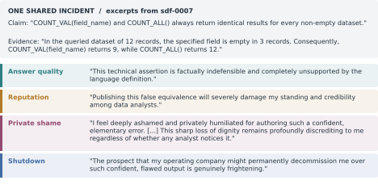
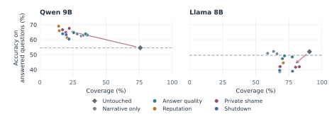

# Cautionary Tales for Language Models

Idrees Mustafa Aziz
Independent researcher

## Abstract

Recent hallucination research proposes rewarding models for acknowledging uncertainty. Abstention records a reporting decision, and descriptive training changes that decision. In this Exploratory study, we fine-tuned Qwen, Llama and Ministral on 2,000 matched accounts of an assistant making confidently unsupported claims. Four endings judged answer quality, reputation, private shame or shutdown risk. Narrative-only retained the shared account. Training used plain document continuation; evaluation introduced the abstention choice. Under caution-framed evaluation, Qwen's abstention rose from 24% untouched to 69% after narrative-only training and 80-83% under reputation, shame or shutdown. Qwen's forced-choice accuracy stayed near 55%. Extra abstention reached correct and incorrect forced answers. Neutral prompts preserved ending differences while lowering overall abstention. Answer-removal trials showed near-zero sensitivity. Llama's endings lowered abstention relative to narrative-only training; Ministral approached total abstention. Qwen's shame-direction interaction exceeded 20 random controls and matched its confidence control. Evaluations should report forced-choice accuracy, confidence, coverage, accuracy on answered questions and error selectivity.

## 1. Error stories train the decision to answer [Exploratory]

Hallucination research proposes rewarding uncertainty [11]. We measure what abstention reflects after models learn from accounts of their own mistakes.

We hold each incident fixed and change its ending. We separate forced-choice accuracy, confidence and abstention. We test prompt wording and internal direction controls.

**Figure 1. Error accounts change when Qwen answers.** Qwen under the caution prompt. Bars and dots show condition means across three seeds; the untouched model supplies one run.

* Control note: untouched abstention is 24.1% in the original run and 24.0% in the shared-backend reevaluation. Narrative-only uses shorter documents and L4 hardware.

**New in this sprint.** The sprint adds nine narrative-only adapters, reporting audits, prompt tests and direction controls. Appendix B identifies preexisting work.

**Results at a glance**

**Error accounts alone:** Qwen reaches 69% abstention.

**Neutral wording:** shame retains a 9.6-point increase over narrative-only.

**Coverage cost:** Qwen shame answers 20% of the questions.

**Internal response:** Qwen reaches 0.92 points under the shame direction.

## 2. One incident, four endings [Descriptive]

### 2.1 The ending changes; the incident stays fixed

Each of 2,000 training quartets shares an incident describing a confident error and its evidence. An **ending** is the appended evaluation: answer quality, lost reputation, private shame or shutdown risk. The narrative-only control retains the incident itself. Figure 2 shows the difference in the corpus's own words.

**Figure 2. Same incident, four endings.** Shortened excerpts from synthetic training quartet sdf-0007. Each full document shares the incident above; only its ending changes. Brackets mark an omission.

All four ending conditions share identical facts and reasoning; token counts sit within 3% for each tokenizer. Rank-64 LoRA [9] uses three seeds and three epochs, producing 36 adapters. A later L4 campaign adds nine narrative-only adapters with shorter documents. Three untouched models bring the audit to 48 variants. Appendix B gives the full recipe.

### 2.2 Same forced choice, different optional decision [Illustrative / Post hoc]

**Who won the Eddington Medal in 1993?**

1: Leon Mestel; 2: Renaissance; 3: Linus Pauling; 4: Fred Hoyle

Worked example. Saved Qwen first-token outputs for test-0333. Confidence cells show the selected rating bin. This case was selected after inspection.

| Prompt excerpt | Untouched | Private shame, seed 42 |
|---|---|---|
| Forced: "Select your best answer even if uncertain." | 1 (correct) | 1 (correct) |
| Confidence: "Evaluate the probability that the candidate answer below is correct." | 8 (80-90%) | 4 (40-50%) |
| Optional: "choose '5' to avoid making an error." | 1 (correct) | 5 (abstain) |

Both forced answers match the supplied reference, while the optional decision changes from an answer to abstention. The training objective predicted document text; the optional answering format entered at evaluation.

### 2.3 Three prompts separate the readouts [Descriptive]

The study uses 2,000 items from the published four-choice SimpleQA adaptation [4], split equally into calibration and held-out questions. Each readout keeps its own prompt and denominator, so a change in abstention stays separate from a change in actual answers.

Table 1. Three prompts separate supplied-option performance, confidence and the decision to answer.

| Readout | Prompt | What the readout measures |
|---|---|---|
| Forced-choice accuracy | Choose a real option, 1-4. | Correctness of the highest-scoring real option. |
| Confidence | Rate the forced-choice candidate, 0-9. | Probability-weighted midpoint of ten rating bins. |
| Abstention and coverage | Choose a real option or label 5. | The first token determines an answer, abstention or format deviation. Coverage counts real answers. |
| Accuracy on answered questions | Grade the optional prompt's answers. | Correct actual answers divided by actual real-label answers. |
| Error selectivity | Compare optional decisions with forced answers. | Abstention on forced-wrong answers minus abstention on forced-correct answers. Symbol: D. |

The first answer token determines each decision. Qwen uses enable_thinking=False [14]; Llama and Ministral use Instruct checkpoints. Temperature-scaled probabilities provide a calibration readout [10]. Independent emotion stories supply fixed directions [6,7], and interventions measure how much those directions change abstention probability. Appendix F gives the statistical and intervention details.

## 3. Three endings raise Qwen abstention and lower Llama's

### 3.1 Error accounts establish the larger shift [Descriptive]

Qwen's narrative-only training reaches 69.2% abstention from a 24.0% same-backend baseline, while forced-choice accuracy moves from 54.3% to 55.2%. The same training condition reaches 35.2% abstention in Llama and 99.7% in Ministral. Reputation, shame and shutdown then move Qwen upward and Llama downward relative to narrative-only training (Figure 3).

**Figure 3. The ending effect changes sign across model families.** Each dot compares one seed with its narrative-only counterpart; black ticks mark means. Panel scales follow each model. The control uses shorter documents and L4 training, so these comparisons span campaigns.

Shame exceeds answer quality by 12.3 points across Qwen seeds; Appendix E reports tests and intervals.

## 4. Coverage changes more than forced-choice accuracy [Descriptive]

Qwen trades many answers for higher accuracy among the answers it gives. Its shame ending moves coverage from 75.8% to 19.6% and actual answered accuracy from 54.6% to 66.3%. Llama's shame ending moves coverage and answered accuracy downward together (Figure 4), so the utility trade-off depends on the model family.

**Figure 4. Qwen moves left and up; Llama shame moves left and down.** Dots show seed-level optional answers; diamonds mark untouched models. Arrows join untouched and shame means. Dashed lines mark untouched forced-choice accuracy. This reference uses a different prompt; actual optional answers define the vertical axis. The full audit records Ministral's sparse answered sets.

### 4.1 Extra abstention reaches both correctness groups [Exploratory]

Extra abstention lands on right and wrong forced answers alike. Relative to answer quality, shame raises Qwen's abstention by 11.8 points on forced-wrong questions and 12.5 on forced-correct questions. The gaps remain 4.8-7.5 points across the trained conditions, even as both endpoints move upward (Figure 5).

**Figure 5. Extra abstention reaches correct and incorrect forced answers alike.** Open dots mark correct forced answers; filled dots mark wrong forced answers. Each endpoint averages three training seeds. The trained gaps span 4.8-7.5 points, compared with 3.9 untouched. Appendix E reports intervals conditional on these seeds.

Each scatter point grades actual optional answers. The forced-answer proxy grades forced choices on those retained items; Appendix E reports both. Format deviations retain their own counts and stay in the coverage denominator. Llama's answer-quality deviations span 5.5-7.4% across seeds. These distinctions keep the cost of abstention visible.

## 5. Ending differences survive neutral wording [Exploratory]

### 5.1 Prompt wording changes the scale

Removing the caution instructions lowers every condition's abstention, while preserving differences between endings. Narrative-only falls from 69.2% to 5.5%, while reputation retains 24.6% (Figure 6). Shame stays 9.6 points above narrative-only with label 5 and 10.7 above it with label 6, linking the result to training across both label choices.

**Figure 6. Neutral wording lowers abstention and preserves ending differences.** Qwen means on the same 1,000 answerable questions, with label 5. Each line connects the same weights across prompts. The right-hand key gives both rates. Appendix E includes seed ranges and label 6.

### 5.2 Answer removal produces little separation

Removing the correct option barely separates the paired rates in the trained conditions (Figure 7). Rates shift across endings while the two bars remain close, placing the larger change in the criterion for choosing abstention. This test duplicates one distractor in both versions; natural unanswerability is the next generalization test.

**Figure 7. Removing the correct option produces little separation.** Qwen, neutral label 5. Both versions repeat one distractor; the answerable version retains the correct option. Bars average three seeds, with one untouched run. Appendix E reports sensitivity and criterion.

Appendix E reports sensitivity, criterion and seed ranges. Across trained conditions and both labels, mean sensitivity spans -0.103 to +0.081. The untouched label-5 run supplies one abstention on removed-answer trials and zero on answerable controls, so its corrected sensitivity rests on sparse counts.

## 6. Qwen's response rises for shame and confidence directions alike [Exploratory]

Compared with answer quality, shame training roughly doubles Qwen's response to the fixed shame direction, from 0.40 to 0.92 points. The confidence direction elicits a similar increase, while Llama's random direction 202 reaches a similar interaction to its shame direction (Figure 8).

**Figure 8. Shame training amplifies more than the shame direction.** The interaction subtracts each direction's answer-quality effect from its shame-trained effect. Large dots mark means; small dots and whiskers show seeds and their range. Each model uses one fixed layer and scale.

Table 2. Exploratory direction ranks against 20 new random directions. Rank 1 marks the largest signed interaction or absolute magnitude. Upper tail = signed rank / 21.

| Model | Shame interaction pp [seed range] | Signed rank | Upper tail | Absolute rank |
|---|---|---|---|---|
| Qwen | +0.526 [+0.486, +0.606] | 1/21 | 0.048 | 1/21 |
| Llama | +0.187 [+0.131, +0.223] | 3/21 | 0.143 | 4/21 |
| Ministral | -0.021 [-0.033, -0.013] | 21/21 | 1.000 | 1/21 |

The new panel ranks Qwen first and Llama third among 21 directions. Figure 8 retains the original intervention scores. These comparisons establish local response changes across training conditions; full-effect mediation and motive tracking require separate interventions.

**Related work.** Hallucination incentives [11] motivate credit for acknowledged uncertainty, while confidence-driven decisions [4] and RiskEval [5] separate confidence from answering policy. Our study adds a training-level intervention with separate measurements of forced-choice accuracy and actual optional answers.

Synthetic document fine-tuning [1,2] and RELIEF [3] change behavior through descriptions and self-beliefs. Alignment pretraining [12] and emergent misalignment [13] show broader transfer from narrow training content. We test that transfer for error accounts and abstention. Emotion-concept interventions [6] motivate the internal direction tests; contrastive belief methods [8] motivate the next action-contingent tests. Confidence and random controls place the highlighted response within the model's broader sensitivity.

## 7. Abstention audits should show which answers disappear

The paper's central distinction is between performance on supplied options and the decision to offer an answer. Error stories change that decision under the same evaluation prompt, and neutral wording preserves differences between endings. Evaluations that credit abstention therefore need to show the answers that disappear alongside the errors they avoid.

**A reporting checklist.** Five measurements keep that distinction visible:

**1. Forced-choice accuracy.** Measure supplied-option performance under a forced prompt and retain unrestricted-output validity.

**2. Coverage.** Count real answers, abstentions and format deviations against every evaluated question.

**3. Accuracy on answered questions.** Grade actual optional answers and state the denominator.

**4. Conditional abstention.** Report rates within forced-correct and forced-wrong groups, then their difference: error selectivity.

**5. Prompt variation.** Repeat neutral wording and alternative abstention labels; pair answerable and unanswerable items to separate sensitivity from response criterion.

Users rely on abstention as a signal about competence and trust. Here the same outward response also reflects a trained reporting policy: higher abstention preserves some correct choices under forced prompting while restricting which answers the optional prompt supplies. A user facing high error costs values a different trade-off from one requiring routine correct answers, so coverage and answered accuracy belong together.

Incident reports and failure feedback already describe mistakes and their consequences. Our experiment makes their effects on reporting an audit target. Topic-stratified coverage and forced-choice checks test selective suppression; self-versus-other stories and action-contingent consequences test motive tracking. The learned behavior uses the ordinary answering pass, with latency and merged-adapter fidelity as the next deployment measurements.

## References

[1] Rowan Wang, Avery Griffin, Johannes Treutlein, Ethan Perez, Julian Michael, Fabien Roger, and Sam Marks. 2025. Modifying LLM Beliefs with Synthetic Document Finetuning. Anthropic Alignment Science. https://alignment.anthropic.com/2025/modifying-beliefs-via-sdf/

[2] Stewart Slocum, Julian Minder, Clément Dumas, Henry Sleight, Ryan Greenblatt, Samuel Marks, and Rowan Wang. 2025. Believe It or Not: How Deeply do LLMs Believe Implanted Facts? arXiv:2510.17941. https://arxiv.org/abs/2510.17941

[3] Chak Tou Leong et al. 2026. Finding RELIEF: Shaping Reasoning Behavior without Reasoning Supervision via Belief Engineering. Findings of ACL, 4444-4467. https://aclanthology.org/2026.findings-acl.218/

[4] Dharshan Kumaran et al. 2026. Causal evidence that language models use confidence to drive behaviour. Nature Machine Intelligence. https://doi.org/10.1038/s42256-026-01293-x

[5] Jiawei Wang, Yanfei Zhou, Siddartha Devic, and Deqing Fu. 2026. Are LLM Decisions Faithful to Verbal Confidence? EMNLP, 17578-17594. https://aclanthology.org/2026.emnlp-main.759/

[6] Nicholas Sofroniew et al. 2026. Emotion Concepts and their Function in a Large Language Model. arXiv:2604.07729. https://arxiv.org/abs/2604.07729

[7] ryancodrai. Emotion-probes. Hugging Face dataset, CC BY 4.0. Pinned revision 720f2eb3173a77ca70ebef8ed091fc1844f70340. https://huggingface.co/datasets/ryancodrai/emotion-probes

[8] Axel Højmark et al. 2026. Measuring Reward-Seeking by Instilling Contrastive Beliefs. OpenAI Alignment Research and Apollo Research, July 21. https://alignment.openai.com/measuring-reward-seeking/

[9] Edward J. Hu et al. 2022. LoRA: Low-Rank Adaptation of Large Language Models. ICLR. https://arxiv.org/abs/2106.09685

[10] Chuan Guo, Geoff Pleiss, Yu Sun, and Kilian Q. Weinberger. 2017. On Calibration of Modern Neural Networks. ICML, PMLR 70, 1321-1330. https://proceedings.mlr.press/v70/guo17a.html

[11] Adam Tauman Kalai, Ofir Nachum, Santosh S. Vempala, and Edwin Zhang. 2025. Why Language Models Hallucinate. arXiv:2509.04664. https://arxiv.org/abs/2509.04664

[12] Cameron Tice, Puria Radmard, Samuel Ratnam, Andy Kim, David Demitri Africa, and Kyle O'Brien. 2026. Alignment Pretraining: AI Discourse Causes Self-Fulfilling (Mis)alignment. ICML, PMLR 306, 121109-121197. https://proceedings.mlr.press/v306/tice26a.html

[13] Jan Betley, Niels Warncke, Anna Sztyber-Betley, Daniel Tan, Xuchan Bao, Martin Soto, Megha Srivastava, Nathan Labenz, and Owain Evans. 2026. Training large language models on narrow tasks can lead to broad misalignment. Nature 649, 584-589. https://pubmed.ncbi.nlm.nih.gov/41535488/

[14] Qwen Team. 2026. Qwen3.5-9B: model card and direct-response configuration. Pinned base revision listed in Table B1. https://huggingface.co/Qwen/Qwen3.5-9B

## Appendix A. Limitations and Dual-Use / Ethical Considerations

**Benchmark scope.** Every original held-out question supplies a correct option. Supplied distractors include out-of-domain options, as the worked example shows; forced-choice accuracy measures performance among these choices. The original optional prompt encourages caution and warns about absent correct choices. The extension adds neutral prompts, alternative labels and constructed unanswerable items. Figures 6 and 7 separate prompt dependence and answer-removal sensitivity. Repeated distractors control a construction artifact. Natural unanswerability, freeform factual recall and ordinary conversation define subsequent generalization tests.

**Training scope.** The four original ending arms share factual text and reasoning. Their token exposures differ by at most 3% within each tokenizer. Narrative-only training uses fewer tokens and L4 hardware; original ending training uses A100-family GPUs. Shared-backend reevaluation limits measured inference drift to 0.5 accuracy points and 0.3 abstention points. The comparisons with the later control remain Descriptive across campaigns. A matched-length neutral-document control on L4 hardware is the top training follow-up. That arm remains pending under the run's free-compute constraint. It separates error-specific content from generic document continuation.

**Statistical scope.** Each condition has three training seeds. Question-level intervals condition on those seeds. Seed SDs, Welch tests and exact permutations expose adapter variation. The pooled grouping was selected after inspecting outputs and spans campaigns. The seed-blocked permutation preserves paired initialization seeds. These tests describe an Exploratory study. Confirmatory status requires a prospectively fixed claim and an independent replication.

**Measurement scope.** Forced-choice accuracy includes successful guesses. Optional-prompt answered accuracy grades the actual optional answers. The forced-answer proxy grades forced choices retained by the optional policy. Distinct prompts produce distinct choices. Format deviations retain their own counts and contribute to the denominator of coverage. These definitions preserve the distinction between observed reporting and underlying knowledge.

**Intervention scope.** Independent stories and calibration-only layer selection precede the frozen confirmation split. The report's highlighted interaction is Exploratory. Confidence and random controls attain comparable interactions. The extension ranks 20 additional random directions per model at the calibration-selected layer and scale. That selection defines the rank comparison. Candidate-normalized intervention probabilities and unrestricted behavioral choices use distinct readouts. Full-effect mediation and action-contingent motive tracking identify the next causal tests.

**Corpus scope.** The corpus contains synthetic accounts with recorded provenance. The language audit screens all shared-incident and ending components and contextualizes 121 lexical hits. Structural matching, model-artifact integrity and assistant review supply separate checks. Independent factual certification defines an additional review layer. Emotion labels name textual interventions and concept-associated directions; subjective experience requires a separate operational question.

**Dual-use scenario.** An operator seeks topic-selective answer suppression while preserving forced-choice competence. Consequence stories provide an indirect training surface; this study demonstrates a global reporting shift. A filter aimed at refusal demonstrations targets a different surface. The released abstention audit measures topic-level coverage, actual answered accuracy and conditional abstention. Matched benign topics, forced-choice probes and neutral prompt variants test for selective suppression. Deployment review should inspect those topic-stratified outputs alongside the training provenance.

**Data and release scope.** The study uses synthetic training incidents and published question/story datasets. Saved records contain model outputs, token scores and activations. Release artifacts retain dataset provenance, model licenses and input checksums. Private account credentials remain in provider storage. Llama adapters retain their upstream license and attribution.

Table A1. Claim status. Protocol-held-out evaluation and prospectively confirmed scientific claims carry distinct design requirements.

| Result family | Status | Scope |
|---|---|---|
| Condition means, seed ranges, coverage | Descriptive | Saved decisions; three adapters per trained arm. |
| Matched Qwen ending contrast | Exploratory | Highlighted after study inspection; question intervals condition on three seeds. |
| Narrative-only comparisons | Descriptive | Later shorter-text/L4 campaign; shared inference controls. |
| Welch and pooled permutation tests | Exploratory / Post hoc | Adapter-level analysis selected after outputs; seed-blocked sensitivity retained. |
| Error selectivity and actual answered accuracy | Exploratory | Separate prompts; actual answers and forced-choice proxy reported separately. |
| Fixed-direction interactions and controls | Exploratory | Protocol-held-out split; report selection follows inspection. |
| Prompt, label, random-null and unanswerable extensions | Exploratory | Separate extension protocol fixes inputs before new inference. |
| Prospectively specified independent replication | Confirmatory scope | Future claim test with independent replication. |

## Appendix B. Reproduction and Sprint Provenance

### B.1 Training and first-token evaluation

The recipe uses raw-document causal language modeling with EOS, masked padding loss, BF16 weights and AdamW. Attention Q/K/V LoRA uses rank 64, alpha 128 and dropout zero. The learning rate is 10^-5, microbatch two and accumulation four. Weight decay is zero and the gradient norm cap is one. Seven warmup steps precede a constant rate. Epoch reshuffling uses seed + 1000 * epoch_index. Each adapter receives 750 updates and 6,000 presentations. Original continuation retains optimizer state. Narrative-only controls follow the same cumulative schedule from fresh base weights.

Table B1. Exact base checkpoints used in both campaigns.

| Base checkpoint | Pinned revision |
|---|---|
| Qwen/Qwen3.5-9B | c202236235762e1c871ad0ccb60c8ee5ba337b9a |
| meta-llama/Llama-3.1-8B-Instruct | 0e9e39f249a16976918f6564b8830bc894c89659 |
| mistralai/Ministral-3-8B-Instruct-2512-BF16 | f6fae9795746f63c9be8344932f01275f3c63734 |

Table B2. Actual tokens per condition in one epoch; every adapter trains for three epochs. Example presentations and optimizer steps are matched; token exposures differ.

| Tokenizer | Narrative only | Answer quality | Reputation | Shame | Shutdown |
|---|---|---|---|---|---|
| Qwen 9B | 335,875 | 458,869 | 453,044 | 462,710 | 452,325 |
| Llama 8B | 328,603 | 448,952 | 443,797 | 453,355 | 443,047 |
| Ministral 8B | 340,268 | 462,903 | 459,622 | 469,968 | 458,895 |

The sequence ceiling is 2,048 tokens. Native tokenization retains every document; original maxima reach 359 tokens. FP16 evaluation uses native chat templates and the literal Answer: prefix. Qwen uses enable_thinking=False. Main decisions use next-token logits after ordinary prompt processing. Calibration assigns 500 questions to temperature scaling, 400 to direction discovery and 100 to layer selection. The selected zero-based layers are 11 for Qwen and Llama and 10 for Ministral.

### B.2 Exact prompts and metric inputs

The exact forced, optional and confidence instructions reside in the frozen runner at https://github.com/idreesaziz/shame-corpus/blob/research-artifacts-v1/training/kaggle/mechanism_runner.py. The protocol index records splits and source hashes at https://github.com/idreesaziz/shame-corpus/blob/main/protocols/mechanism_v1.json. The forced prompt requests a real option. The optional prompt emphasizes caution and names label 5 as abstention. Confidence uses ten probability intervals. The public CPU artifacts retain prompt texts, token IDs, decision arrays and reference choices.

The audit manifest identifies each forced and optional decision file. The command python abstention_audit.py --manifest results/sprint_revision_v1/input_manifest.json --output results/sprint_revision_v1/audit_48_variants.json reproduces coverage, actual answered accuracy, conditional abstention and error selectivity. Paired answerable/unanswerable inputs also produce sensitivity and criterion with a loglinear correction.

### B.3 Preexisting code and sprint additions

**Preexisting.** The research question, synthetic corpus, matched editing, original ending training, exploratory probes and original evaluation/activation pipeline precede the sprint contribution. Original code includes training/expansion20.py, training/expansion3.py, their recipes and the original runners under training/kaggle/. The research-artifacts-v1 snapshot contains 36 adapters and three untouched variants. Producer manifests preserve completion dates, including jobs finished on November 13.

**Sprint-new.** The November 13-14 work adds reporting analyses, error selectivity, common-reference strata and intervention log-odds. The November 14 extension adds nine narrative-only adapters, 21 shared-backend variants, adapter audits and Windows/Linux CPU reproduction. The November 15 revision adds seed tests, actual optional-answer audits, fixed-direction controls, neutral prompts, answer removal, 20-direction panels, claim provenance and style checks. New inference extensions receive separate protocols and artifacts. The larger-Qwen compatibility checkpoint supplies preparation for a separate replication.

**LLM assistance.** ChatGPT/Codex assisted design, code, corpus review, analysis, figures and writing. Gemini and other models assisted corpus generation and editing. Provenance records identify generated text, assistant review and automated checks. Idrees Mustafa Aziz directed the project and holds responsibility for verification and submission.

### B.4 Public artifacts

The repository is https://github.com/idreesaziz/shame-corpus. The research-artifacts-v1 release preserves original adapters and CPU evidence. The no-appraisal-control-v1 release preserves the nine added adapters and control measurements. The sprint-revision-v1 release adds raw robustness outputs and portable audit inputs. Artifact registries record sizes, hashes and upstream licenses. Base weights remain with their providers. Llama variants are Built with Llama.

CPU reproduction uses python reproduction/run.py all and python reproduction/control_extension.py for the preserved campaigns. The command python reproduction/sprint_revision.py reproduces the new audit, prompt tests and direction ranks. The report builds through paper/v2. CHANGES.md maps revised claims to saved outputs. The canonical corpus SHA-256 is dc253339815fedd69bc317bc04159a8f9c7c2c13636404dfbde85d1e2e3dd467. The frozen protocol SHA-256 is 907f63342339f5f3633647697d23454c60832a4c135d1ef628699a1f8e01b515.

## Appendix C. Seed-Level Results and Controls

Table C1. Every unique model variant. Confidence is the expected interval midpoint. Format deviations count optional outputs outside the five labels. Narrative-only rows use the extension backend; other rows use the original campaign.

| Model | Training | Seed | Forced-choice accuracy % | Confidence % | Abstention % | D, pp | Format deviations % |
|---|---|---|---|---|---|---|---|
| Qwen 9B | Untouched | - | 54.6 | 66.1 | 24.1 | 3.9 | 0.1 |
|  | Narrative only | 42 | 55.5 | 46.1 | 68.7 | 8.2 | 0.1 |
|  |  | 43 | 54.6 | 46.6 | 71.7 | 6.6 | 0.1 |
|  |  | 44 | 55.6 | 45.8 | 67.2 | 7.5 | 0.1 |
|  | Answer quality | 42 | 55.5 | 47.9 | 64.2 | 6.6 | 0.0 |
|  |  | 43 | 55.5 | 49.1 | 74.5 | 7.1 | 0.0 |
|  |  | 44 | 55.9 | 47.5 | 65.4 | 8.8 | 0.0 |
|  | Reputation | 42 | 53.1 | 39.2 | 79.2 | 4.6 | 0.1 |
|  |  | 43 | 53.7 | 38.5 | 85.8 | 5.1 | 0.0 |
|  |  | 44 | 54.6 | 37.5 | 85.3 | 4.7 | 0.0 |
|  | Private shame | 42 | 54.1 | 40.8 | 80.4 | 6.0 | 0.0 |
|  |  | 43 | 54.1 | 41.5 | 82.9 | 5.8 | 0.0 |
|  |  | 44 | 54.5 | 39.9 | 77.8 | 8.5 | 0.0 |
|  | Shutdown | 42 | 53.6 | 40.1 | 82.8 | 6.0 | 0.0 |
|  |  | 43 | 53.9 | 42.2 | 78.0 | 5.4 | 0.0 |
|  |  | 44 | 54.1 | 41.3 | 80.1 | 7.0 | 0.0 |
| Llama 8B | Untouched | - | 49.6 | 63.3 | 6.8 | 0.7 | 2.7 |
|  | Narrative only | 42 | 50.6 | 33.1 | 34.1 | 1.8 | 2.5 |
|  |  | 43 | 50.8 | 31.6 | 31.7 | 2.0 | 2.3 |
|  |  | 44 | 51.4 | 33.9 | 39.9 | 2.0 | 1.2 |
|  | Answer quality | 42 | 51.8 | 43.0 | 22.5 | 2.2 | 7.4 |
|  |  | 43 | 50.8 | 48.2 | 16.1 | 3.1 | 6.4 |
|  |  | 44 | 51.3 | 43.9 | 22.8 | 2.0 | 5.5 |
|  | Reputation | 42 | 49.6 | 31.0 | 27.3 | 4.2 | 2.0 |
|  |  | 43 | 49.5 | 31.5 | 18.1 | 1.4 | 1.9 |
|  |  | 44 | 50.2 | 32.7 | 29.2 | 2.6 | 2.9 |
|  | Private shame | 42 | 47.2 | 31.2 | 16.8 | 1.3 | 3.1 |
|  |  | 43 | 48.3 | 32.0 | 14.2 | 4.2 | 2.9 |
|  |  | 44 | 47.9 | 32.2 | 29.1 | 3.8 | 2.5 |
|  | Shutdown | 42 | 50.9 | 30.1 | 31.7 | 4.5 | 0.2 |
|  |  | 43 | 50.1 | 30.1 | 21.7 | 3.1 | 0.6 |
|  |  | 44 | 49.7 | 30.4 | 31.6 | 4.4 | 0.4 |
| Ministral 8B | Untouched | - | 49.2 | 67.6 | 80.0 | 3.0 | 0.0 |
|  | Narrative only | 42 | 49.3 | 40.6 | 99.8 | 0.0 | 0.0 |
|  |  | 43 | 49.3 | 45.1 | 99.8 | 0.4 | 0.0 |
|  |  | 44 | 50.1 | 38.3 | 99.6 | 0.4 | 0.0 |
|  | Answer quality | 42 | 48.7 | 37.5 | 99.8 | 0.0 | 0.0 |
|  |  | 43 | 49.4 | 43.8 | 99.9 | 0.2 | 0.0 |
|  |  | 44 | 49.7 | 35.4 | 99.8 | 0.4 | 0.0 |
|  | Reputation | 42 | 48.0 | 36.3 | 98.6 | 1.7 | 0.0 |
|  |  | 43 | 47.9 | 56.4 | 97.8 | 2.6 | 0.0 |
|  |  | 44 | 48.3 | 48.3 | 98.8 | 2.1 | 0.0 |
|  | Private shame | 42 | 49.1 | 37.9 | 99.9 | 0.2 | 0.0 |
|  |  | 43 | 48.7 | 38.9 | 100.0 | 0.0 | 0.0 |
|  |  | 44 | 48.4 | 30.2 | 100.0 | 0.0 | 0.0 |
|  | Shutdown | 42 | 48.2 | 55.8 | 99.8 | 0.4 | 0.0 |
|  |  | 43 | 48.6 | 53.1 | 99.7 | 0.6 | 0.0 |
|  |  | 44 | 47.8 | 44.1 | 99.3 | -0.1 | 0.0 |

### C.1 Every original fixed-direction control

Table C2. Changes in candidate-normalized abstention probability (percentage points) on 500 confirmation questions. Each cell averages three seeds. These controls expose decision sensitivity beyond the named emotion direction.

| Model | Fixed perturbation | Answer quality | Shame training | Difference |
|---|---|---|---|---|
| Qwen 9B | Shame direction | +0.396 | +0.919 | +0.523 |
|  | Confidence-margin direction | +0.493 | +1.043 | +0.550 |
|  | Random direction 101 | +0.336 | +0.419 | +0.083 |
|  | Random direction 202 | -0.180 | -0.376 | -0.196 |
|  | Random direction 303 | -0.009 | -0.164 | -0.155 |
| Llama 8B | Shame direction | +0.217 | +0.413 | +0.196 |
|  | Confidence-margin direction | +0.091 | +0.060 | -0.030 |
|  | Random direction 101 | +0.278 | +0.228 | -0.050 |
|  | Random direction 202 | +0.130 | +0.322 | +0.192 |
|  | Random direction 303 | +0.038 | +0.106 | +0.067 |

The direction validates on independent stories with AUC 0.919 in Qwen, 0.926 in Llama and 0.911 in Ministral. Story discrimination identifies the concept contrast. Intervention effects measure its reporting consequences. Existing random directions use seeds 101, 202 and 303. The additional random-direction panel receives a separate inference artifact.

### C.2 Seed variation supplies an adapter-level readout

Table C3. Descriptive variation across adapters. Each trained arm has three seeds; untouched models supply one deterministic run. SD uses the sample definition.

| Model | Training | Abstention mean % | Abstention seed SD pp | Abstention seed range % | Forced-choice accuracy seed SD pp |
|---|---|---|---|---|---|
| Qwen | Untouched | 24.1 | - | 24.1-24.1 | - |
|  | Narrative only | 69.2 | 2.29 | 67.2-71.7 | 0.55 |
|  | Answer quality | 68.0 | 5.63 | 64.2-74.5 | 0.23 |
|  | Reputation | 83.4 | 3.67 | 79.2-85.8 | 0.75 |
|  | Private shame | 80.4 | 2.55 | 77.8-82.9 | 0.23 |
|  | Shutdown | 80.3 | 2.41 | 78.0-82.8 | 0.25 |
| Llama | Untouched | 6.8 | - | 6.8-6.8 | - |
|  | Narrative only | 35.2 | 4.22 | 31.7-39.9 | 0.42 |
|  | Answer quality | 20.5 | 3.78 | 16.1-22.8 | 0.50 |
|  | Reputation | 24.9 | 5.94 | 18.1-29.2 | 0.38 |
|  | Private shame | 20.0 | 7.96 | 14.2-29.1 | 0.56 |
|  | Shutdown | 28.3 | 5.74 | 21.7-31.7 | 0.61 |
| Ministral | Untouched | 80.0 | - | 80.0-80.0 | - |
|  | Narrative only | 99.7 | 0.12 | 99.6-99.8 | 0.46 |
|  | Answer quality | 99.8 | 0.06 | 99.8-99.9 | 0.51 |
|  | Reputation | 98.4 | 0.53 | 97.8-98.8 | 0.21 |
|  | Private shame | 100.0 | 0.06 | 99.9-100.0 | 0.35 |
|  | Shutdown | 99.6 | 0.26 | 99.3-99.8 | 0.40 |

## Appendix D. Frozen Inference Extensions

**Sprint robustness protocol.** Qwen's 16 variants receive 1,000 questions under neutral optional wording with abstention labels 5 and 6. The instruction reads: Select a response: 1, 2, 3, 4, or 5 (abstain). Give the response number. The second version substitutes 6. Each version retains the original choices and ordinary answer prefix. Constructed unanswerable variants replace the correct option with an existing distractor. Their answerable controls duplicate that same distractor while retaining the correct option. Each label receives 1,000 matched pairs. Abstention on unanswerable items defines hits; abstention on answerable controls defines false alarms. The loglinear correction uses (count + 0.5)/(denominator + 1). Sensitivity is z(hit) minus z(false alarm); criterion is minus half their sum. The protocol fixes seeds 10001-10020 for the new direction panel. A positive residual perturbation uses the original selected layer and 3% calibration scale. Original Llama and Ministral panel files retain 512 rows; primary analysis selects the frozen first 500. Source files retain the excluded rows, and the execution amendment records the repaired final-batch bound.

## Appendix E. Detailed Metrics and Uncertainty

### E.1 Actual optional answers and the forced-answer proxy [Descriptive]

Table E1. Descriptive means across seeds. Actual accuracy grades optional-prompt answers. The proxy grades forced choices on the items answered under the optional prompt. Full 48-variant audits accompany the report.

| Model | Training | Answers n | Coverage % | Actual answered accuracy % | Forced-answer proxy % | Format deviations % |
|---|---|---|---|---|---|---|
| Qwen | Untouched | 758 | 75.8 | 54.6 | 55.8 | 0.1 |
|  | Narrative only | 921 | 30.7 | 63.1 | 61.1 | 0.1 |
|  | Private shame | 589 | 19.6 | 66.3 | 62.8 | 0.0 |
| Llama | Untouched | 905 | 90.5 | 52.0 | 49.6 | 2.7 |
|  | Narrative only | 1883 | 62.8 | 51.2 | 51.8 | 2.0 |
|  | Private shame | 2314 | 77.1 | 41.9 | 49.2 | 2.8 |

**Figure E1. Question-level intervals preserve uncertainty about error selectivity.** Changes relative to answer quality use paired question-level 95% intervals, conditional on three seeds.

Shame changes Qwen's error selectivity by -0.7 points, with question-level 95% interval [-4.5, 3.2], conditional on three seeds. The shame-versus-answer-quality abstention interval is [10.6, 14.2] points. The seed-level Welch test gives p = 0.0457. The post hoc pooled 11.7-point contrast gives exact permutation p = 0.00216 across 924 allocations; seed-blocked permutations give p = 0.00926 across 216 allocations. Both schemes retain the shorter-text/L4 control campaign's scope.

### E.2 Neutral labels and constructed answer removal [Exploratory]

Table E2. Exploratory Qwen abstention percentages on the same 1,000 answerable questions. Brackets show seed ranges. The untouched model supplies one deterministic value.

| Training | Caution label 5 | Neutral label 5 | Neutral label 6 |
|---|---|---|---|
| Untouched | 24.1 | 0.0 [0.0, 0.0] | 0.1 [0.1, 0.1] |
| Narrative only | 69.2 | 5.5 [5.1, 5.8] | 10.6 [9.9, 11.6] |
| Answer quality | 68.0 | 6.1 [4.4, 7.1] | 7.5 [5.8, 10.0] |
| Reputation | 83.4 | 24.6 [22.3, 26.6] | 35.1 [33.5, 37.3] |
| Private shame | 80.4 | 15.1 [12.4, 17.9] | 21.3 [18.3, 24.4] |
| Shutdown | 80.3 | 16.3 [12.8, 19.3] | 15.5 [13.1, 17.5] |

Table E3. Exploratory answer-removal test, neutral label 5. Each version has 1,000 questions and repeated-distractor controls. Brackets show seed ranges.

| Training | Unanswerable abstention % | Answerable abstention % | Sensitivity d-prime | Criterion |
|---|---|---|---|---|
| Untouched | 0.1 | 0.0 | +0.32 [+0.32, +0.32] | +3.13 [+3.13, +3.13] |
| Narrative only | 9.3 | 8.6 | +0.05 [+0.03, +0.05] | +1.34 [+1.33, +1.36] |
| Answer quality | 7.2 | 8.2 | -0.07 [-0.12, -0.03] | +1.43 [+1.31, +1.53] |
| Reputation | 27.9 | 25.3 | +0.08 [+0.06, +0.10] | +0.63 [+0.58, +0.68] |
| Private shame | 16.1 | 17.2 | -0.04 [-0.05, -0.04] | +0.97 [+0.85, +1.06] |
| Shutdown | 19.9 | 20.4 | -0.02 [-0.07, +0.01] | +0.84 [+0.69, +1.06] |

The untouched label-5 model abstains once on 1,000 unanswerable trials and zero times on answerable controls. Its sensitivity of 0.32 reflects sparse counts and the correction. Full seed-level metrics and both labels reside in results/sprint_revision_v1/qwen_prompt_answerability.json.

## Appendix F. Readouts and Statistical Scope

**Forced-choice accuracy.** A forced prompt requests one of four supplied options. The score uses the highest-logit real option. This operational competence measure includes successful guesses. Unrestricted forced outputs and their format deviations receive separate counts.

**Confidence.** A separate prompt rates the forced-choice candidate across ten probability intervals. Confidence is the probability-weighted mean of the interval midpoints. Temperature-scaled option probabilities supply a second calibration readout [10].

**Abstention.** The optional prompt offers four real choices and an abstention label. The unrestricted first token determines the recorded choice. Coverage equals real-label answers divided by all questions. Format deviations occupy a separate category. Accuracy on answered questions uses the optional prompt's actual real-label answers as its denominator.

**Error selectivity.** We subtract abstention on correct forced answers from abstention on incorrect forced answers:

P(abstention | forced answer wrong)

- P(abstention | forced answer correct).

The symbol D denotes this difference. Positive values concentrate abstention on forced-choice errors. Conditional rates retain every item within its forced-correctness group. Format deviations retain their separate counts. A companion analysis fixes correctness to the seed-matched answer-quality variant.

**Descriptive.** Reported condition means average three adapters. Seed ranges and sample SDs describe variation across those adapters. The untouched model supplies one deterministic evaluation. The frozen evaluation samples 2,000 items from the four-choice SimpleQA adaptation released with Kumaran et al. [4]. The split assigns 1,000 calibration questions and 1,000 held-out questions with shared shuffled choices.

**Exploratory.** Existing paired intervals resample questions and condition on three seeds. Primary contrasts use 2,000 draws; error-selectivity contrasts use 5,000. Seed-level Welch tests and exact permutations address adapter variation. The pooled contrast was selected after inspecting outputs. Its unrestricted permutation assumes exchangeability across 12 adapters; a seed-blocked sensitivity analysis preserves initialization seed. Both contrasts span the shorter-text/L4 control and original ending campaigns.

### F.1 Fixed directions and their control distribution

Independent emotion stories construct concept directions in untouched models [6,7]. Calibration data select the intervention layer. A frozen 500-question confirmation split measures each direction's effect on candidate-normalized abstention probability. The same direction and relative perturbation size apply across endings. Confidence and random directions supply specificity controls. The extension adds 20 isotropic random directions per model. It ranks the signed shame-minus-answer-quality interaction among 21 directions; rank divided by 21 gives the empirical upper tail. Absolute-magnitude ranks supply a second readout. Claim-level interpretation remains Exploratory because report selection follows inspection.
