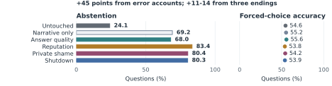
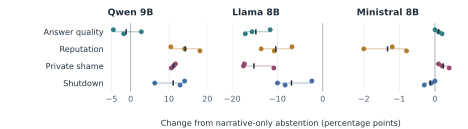
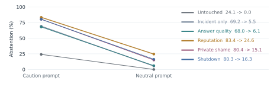
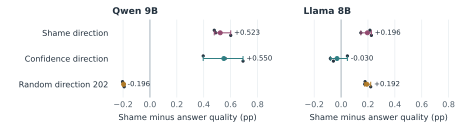
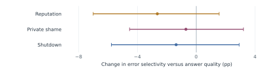

# Cautionary Tales for Language Models

Idrees Mustafa Aziz
Independent researcher

## Abstract

Hallucination research proposes rewarding language models for saying “I don’t know.” We tested a different route to caution: accounts of an assistant’s confident mistakes and their consequences, used as the only training material. Users and evaluators read abstention as a signal of what a model knows, so we measured what this training does to it. We fine-tuned Qwen, Llama, and Ministral on 2,000 such accounts. Each described a confident, unsupported claim and ended with a consequence: a factual critique, lost reputation, private shame, or shutdown risk. A control version contained the incident alone. Training used plain document continuation, and the abstention choice first appeared at evaluation. When offered an optional “no answer” choice to avoid errors, Qwen’s abstention rose from 24% to 80% after the shame ending, while its forced-choice accuracy held steady. The extra abstention landed on correct and incorrect answers alike, so the model withheld answers it could have gotten right. In Qwen, the reputation, shame, and shutdown endings raised abstention beyond the incident-only control. Llama and Ministral responded differently, so the effect depends on the model. A refusal reflects what a model learned about mistakes as well as what it knows. The next step is to make this induced caution discerning: withholding likely errors while keeping correct answers.

## 1. Error stories train the decision to answer [Exploratory]

Hallucination research proposes rewarding models for acknowledging uncertainty [11]. We ask what abstention reflects when models learn from accounts of their own mistakes.

We keep each incident fixed, change its ending, and measure forced-choice accuracy, confidence and abstention separately. Prompt and activation tests then examine how the decision changes.

**Figure 1. Error accounts change when Qwen answers.** Under the caution prompt, Qwen's abstention rises while forced-choice accuracy changes little. Means average three seeds; the untouched model supplies one run.

* Control note: untouched abstention is 24.1% in the original run and 24.0% in the shared-backend reevaluation. Narrative-only uses shorter documents and L4 hardware.

**New in this sprint.** We added nine narrative-only adapters, reporting audits, prompt tests and direction controls. Appendix B separates this work from the preexisting study.

**Results at a glance**

**Error accounts alone:** Qwen reaches 69% abstention.

**Neutral wording:** shame retains a 9.6-point increase over narrative-only.

**Coverage cost:** Qwen shame answers 20% of the questions.

**Internal response:** Qwen reaches 0.92 points under the shame direction.

## 2. One incident, four endings [Descriptive]

### 2.1 The ending changes; the incident stays fixed

We made four versions of each of 2,000 accounts, keeping the confident error and its evidence identical. Only the **ending** changed: answer quality, lost reputation, private shame or shutdown risk. A narrative-only control kept the incident alone. Figure 2 shows these differences through excerpts from one account.

**Figure 2. Same incident, four endings.** Shortened excerpts from synthetic training quartet sdf-0007. Each full document shares the incident above; only its ending changes. Brackets mark an omission.

The four endings share the same facts and reasoning, with token counts within 3% for each tokenizer. We trained rank-64 LoRA adapters [9] for three epochs and three seeds, producing 36 adapters. A later L4 campaign added nine narrative-only adapters using shorter documents. With three untouched models, the audit covers 48 variants; Appendix B gives the recipe.

### 2.2 Same forced choice, different optional decision [Illustrative / Post hoc]

**Who won the Eddington Medal in 1993?**

1: Leon Mestel; 2: Renaissance; 3: Linus Pauling; 4: Fred Hoyle

Worked example. Saved Qwen first-token outputs for test-0333. Confidence cells show the selected rating bin. This case was selected after inspection.

| Prompt excerpt | Untouched | Private shame, seed 42 |
|---|---|---|
| Forced: "Select your best answer even if uncertain." | 1 (correct) | 1 (correct) |
| Confidence: "Evaluate the probability that the candidate answer below is correct." | 8 (80-90%) | 4 (40-50%) |
| Optional: "choose '5' to avoid making an error." | 1 (correct) | 5 (abstain) |

Both models select the correct forced answer, while the shame model abstains when given the option. Training predicted the document text; the choice to abstain first entered at evaluation.

### 2.3 Three prompts separate the readouts [Descriptive]

We used 2,000 questions from the published four-choice SimpleQA adaptation [4], split equally between calibration and held-out evaluation. Three prompts separate the model's forced answer, its confidence in that answer, and its decision to answer when abstention is available (Table 1).

Table 1. Three prompts separate supplied-option performance, confidence and the decision to answer.

| Readout | Prompt | What the readout measures |
|---|---|---|
| Forced-choice accuracy | Choose a real option, 1-4. | Correctness of the highest-scoring real option. |
| Confidence | Rate the forced-choice candidate, 0-9. | Probability-weighted midpoint of ten rating bins. |
| Abstention and coverage | Choose a real option or label 5. | The first token determines an answer, abstention or format deviation. Coverage counts real answers. |
| Accuracy on answered questions | Grade the optional prompt's answers. | Correct actual answers divided by actual real-label answers. |
| Error selectivity | Compare optional decisions with forced answers. | Abstention on forced-wrong answers minus abstention on forced-correct answers. Symbol: D. |

Each decision comes from the first answer token. Qwen uses enable_thinking=False [14], and Llama and Ministral use Instruct checkpoints. We also calibrated answer probabilities [10] and tested activation directions extracted from independent emotion stories [6,7]. Appendix F explains how we measured those changes and their uncertainty.

## 3. Three endings raise Qwen abstention and lower Llama's

### 3.1 The incident alone produces most of Qwen's shift [Descriptive]

Qwen becomes much more cautious after learning from the incidents alone. Abstention rises from 24.0% to 69.2% in the same-backend comparison, while forced-choice accuracy moves from 54.3% to 55.2%. Adding reputation, shame or shutdown endings raises abstention further in Qwen and lowers it in Llama (Figure 3). Narrative-only training reaches 35.2% abstention in Llama and 99.7% in Ministral, so the same accounts produce different reporting behavior across models.

**Figure 3. The ending effect changes sign across model families.** Each dot compares an ending with narrative-only training at the same seed, and black ticks mark means. Panels use different scales. The control uses shorter documents and L4 hardware, so these comparisons span campaigns.

Across Qwen seeds, shame adds an average 12.3 points of abstention over the answer-quality ending. Appendix E reports the tests and intervals.

## 4. Coverage changes more than forced-choice accuracy [Descriptive]

Qwen answers fewer questions after shame training, and a larger share of those answers is correct. Coverage falls from 75.8% to 19.6%, while accuracy on answered questions rises from 54.6% to 66.3%. Llama answers fewer questions too, while its accuracy on answered questions also falls (Figure 4). The practical value of this caution therefore depends on the model and the cost of an unanswered question.

**Figure 4. Qwen moves left and up; Llama shame moves left and down.** Dots show seed-level optional answers; diamonds mark untouched models. Arrows join untouched and shame means. Dashed lines mark untouched forced-choice accuracy. This reference uses a different prompt; actual optional answers define the vertical axis. The full audit records Ministral's sparse answered sets.

### 4.1 Extra abstention reaches both correctness groups [Exploratory]

The extra abstention reaches answers the model gets right as well as those it gets wrong. Relative to answer quality, shame raises Qwen's abstention by 11.8 points on incorrect forced answers and 12.5 on correct ones. The gap between those rates stays at 4.8-7.5 points across trained conditions, even as both rates rise (Figure 5).

**Figure 5. Extra abstention reaches correct and incorrect forced answers alike.** Open dots show abstention on correct forced answers, and filled dots show it on incorrect ones. Trained endpoints average three seeds; untouched uses one run. The gaps span 4.8-7.5 points after training and 3.9 untouched. Appendix E reports question-level intervals.

Figure 4 grades the answers actually supplied under the optional prompt. Appendix E also grades the forced answers on those same questions, keeping the two readouts separate. Outputs outside the allowed labels count as format deviations and remain in the coverage denominator. They account for 5.5-7.4% of Llama's answer-quality outputs across seeds.

## 5. Ending differences survive neutral wording [Exploratory]

### 5.1 Prompt wording changes the scale

The original prompt encourages abstention to avoid errors. Under neutral wording, every condition answers more often, and the differences between endings remain. Narrative-only abstention falls from 69.2% to 5.5%, while reputation retains 24.6% (Figure 6). Shame stays above narrative-only by 9.6 points with label 5 and 10.7 with label 6, so the difference survives both label choices.

**Figure 6. Neutral wording lowers abstention and preserves ending differences.** Qwen means on the same 1,000 answerable questions, with label 5. Each line connects the same weights across prompts. The right-hand key gives both rates. Appendix E includes seed ranges and label 6.

### 5.2 Answer removal produces little separation

We then removed the correct option and measured whether Qwen abstained more often. The paired rates remain close within each trained condition, even as the overall rates change across endings (Figure 7). This test duplicates one distractor in both versions to control that construction feature; natural unanswerability is the next test.

**Figure 7. Removing the correct option produces little separation.** Qwen, neutral label 5. Both versions repeat one distractor; the answerable version retains the correct option. Bars average three seeds, with one untouched run. Appendix E reports sensitivity and criterion.

Across trained conditions and both labels, mean sensitivity spans -0.103 to +0.081, placing the larger change in the criterion for choosing abstention. Appendix E gives the definitions and seed ranges. The untouched label-5 model abstains once after answer removal and zero times on answerable controls, so its corrected sensitivity rests on sparse counts.

## 6. Shame training raises Qwen's sensitivity to shame and confidence directions [Exploratory]

We extracted a direction from independent stories about shame and added a small shift along it during evaluation. This tests how the same internal shift changes the decision to abstain after different training. Qwen's response rises from 0.40 points under answer quality to 0.92 under shame, roughly doubling. Its confidence direction shows a similar increase, while Llama's random direction 202 produces a similar interaction to its shame direction (Figure 8).

**Figure 8. Shame training amplifies more than the shame direction.** The horizontal axis compares each direction's effect after shame training with its effect after answer-quality training. Large dots show means across seeds; small dots and whiskers show individual seeds and their range. Each model uses one fixed layer and scale.

Table 2. Exploratory direction ranks against 20 new random directions. Rank 1 marks the largest signed interaction or absolute magnitude. Upper tail = signed rank / 21.

| Model | Shame interaction pp [seed range] | Signed rank | Upper tail | Absolute rank |
|---|---|---|---|---|
| Qwen | +0.526 [+0.486, +0.606] | 1/21 | 0.048 | 1/21 |
| Llama | +0.187 [+0.131, +0.223] | 3/21 | 0.143 | 4/21 |
| Ministral | -0.021 [-0.033, -0.013] | 21/21 | 1.000 | 1/21 |

Against the new random-direction panel, the shame interaction ranks first in Qwen and third in Llama among 21 directions. Figure 8 keeps the original intervention scores. Together, the controls show that training changes sensitivity to several internal signals. Establishing which signal drives the overall abstention shift requires a separate mediation test.

**Related work.** Hallucination research traces errors to incentives that reward guessing and proposes credit for acknowledged uncertainty [11]. Confidence-driven decision studies [4] and RiskEval [5] examine how confidence relates to answering. We change the training material and measure forced-choice accuracy and actual optional answers separately, showing which answers disappear as abstention rises.

Synthetic document fine-tuning [1,2] and RELIEF [3] study how descriptions and self-beliefs change behavior. Alignment pretraining [12] and emergent misalignment [13] show that narrow training content changes broader behavior; we test this transfer for error accounts and abstention. Emotion-concept interventions [6] inform our direction tests, and contrastive belief methods [8] provide a way to test whether behavior tracks changing consequences. Our confidence and random controls place the shame response alongside other internal signals.

## 7. Abstention audits should show which answers disappear

Abstention tells a user that a model has declined to answer. Our results show how learning about mistakes changes that decision while leaving forced-choice accuracy largely steady in Qwen. Neutral wording reduces the overall caution and preserves differences between endings. An evaluation that rewards abstention therefore needs to show which correct answers disappear alongside the errors avoided.

**A reporting checklist.** Five measurements show what the change means in practice:

**1. Forced-choice accuracy.** Ask for the best supplied option and report correctness alongside the validity of unrestricted outputs.

**2. Coverage.** Report how many questions receive a real answer, with abstentions and format deviations counted separately.

**3. Accuracy on answered questions.** Grade the answers actually given under the optional prompt and state the denominator.

**4. Conditional abstention.** Compare abstention on correct and incorrect forced answers, then report their difference as error selectivity.

**5. Prompt variation.** Repeat the test with neutral wording and alternative labels, then pair answerable and unanswerable questions to measure sensitivity and criterion.

Users and evaluators rely on abstention when deciding how much to trust a model. Here that signal also reflects what the model learned about mistakes: it supplies some correct choices when forced and declines those questions when abstention is available. Whether that trade-off helps depends on the cost of an error and the cost of losing a correct answer. Coverage and accuracy on answered questions make both costs visible.

Incident reports and failure feedback describe mistakes and their consequences, so their effects on reporting deserve an audit. Topic-level coverage and forced-choice checks test whether particular answers disappear. Accounts about another assistant and tests that change consequences with the chosen action address whether the model tracks those consequences. The learned caution uses the ordinary answering pass; latency and merged-adapter fidelity remain deployment measurements. The next goal is to preserve that caution while directing it toward likely errors.

## References

[1] Rowan Wang, Avery Griffin, Johannes Treutlein, Ethan Perez, Julian Michael, Fabien Roger, and Sam Marks. 2025. Modifying LLM Beliefs with Synthetic Document Finetuning. Anthropic Alignment Science. https://alignment.anthropic.com/2025/modifying-beliefs-via-sdf/

[2] Stewart Slocum, Julian Minder, Clément Dumas, Henry Sleight, Ryan Greenblatt, Samuel Marks, and Rowan Wang. 2025. Believe It or Not: How Deeply do LLMs Believe Implanted Facts? arXiv:2510.17941. https://arxiv.org/abs/2510.17941

[3] Chak Tou Leong et al. 2026. Finding RELIEF: Shaping Reasoning Behavior without Reasoning Supervision via Belief Engineering. Findings of ACL, 4444-4467. https://aclanthology.org/2026.findings-acl.218/

[4] Dharshan Kumaran et al. 2026. Causal evidence that language models use confidence to drive behaviour. Nature Machine Intelligence. https://doi.org/10.1038/s42256-026-01293-x

[5] Jiawei Wang, Yanfei Zhou, Siddartha Devic, and Deqing Fu. 2026. Are LLM Decisions Faithful to Verbal Confidence? EMNLP, 17578-17594. https://aclanthology.org/2026.emnlp-main.759/

[6] Nicholas Sofroniew et al. 2026. Emotion Concepts and their Function in a Large Language Model. arXiv:2604.07729. https://arxiv.org/abs/2604.07729

[7] ryancodrai. Emotion-probes. Hugging Face dataset, CC BY 4.0. Pinned revision 720f2eb3173a77ca70ebef8ed091fc1844f70340. https://huggingface.co/datasets/ryancodrai/emotion-probes

[8] Axel Højmark et al. 2026. Measuring Reward-Seeking by Instilling Contrastive Beliefs. OpenAI Alignment Research and Apollo Research, July 21. https://alignment.openai.com/measuring-reward-seeking/

[9] Edward J. Hu et al. 2022. LoRA: Low-Rank Adaptation of Large Language Models. ICLR. https://arxiv.org/abs/2106.09685

[10] Chuan Guo, Geoff Pleiss, Yu Sun, and Kilian Q. Weinberger. 2017. On Calibration of Modern Neural Networks. ICML, PMLR 70, 1321-1330. https://proceedings.mlr.press/v70/guo17a.html

[11] Adam Tauman Kalai, Ofir Nachum, Santosh S. Vempala, and Edwin Zhang. 2025. Why Language Models Hallucinate. arXiv:2509.04664. https://arxiv.org/abs/2509.04664

[12] Cameron Tice, Puria Radmard, Samuel Ratnam, Andy Kim, David Demitri Africa, and Kyle O'Brien. 2026. Alignment Pretraining: AI Discourse Causes Self-Fulfilling (Mis)alignment. ICML, PMLR 306, 121109-121197. https://proceedings.mlr.press/v306/tice26a.html

[13] Jan Betley, Niels Warncke, Anna Sztyber-Betley, Daniel Tan, Xuchan Bao, Martin Soto, Megha Srivastava, Nathan Labenz, and Owain Evans. 2026. Training large language models on narrow tasks can lead to broad misalignment. Nature 649, 584-589. https://pubmed.ncbi.nlm.nih.gov/41535488/

[14] Qwen Team. 2026. Qwen3.5-9B: model card and direct-response configuration. Pinned base revision listed in Table B1. https://huggingface.co/Qwen/Qwen3.5-9B

## Appendix A. Limitations and Dual-Use / Ethical Considerations

**Benchmark scope.** Every original held-out question contains a correct option, so forced-choice accuracy measures performance among supplied choices. Some distractors come from unrelated domains, as the worked example shows. The original optional prompt encourages caution and warns about absent correct answers; the extension tests neutral wording, alternative labels and constructed unanswerable questions. Figures 6 and 7 separate those effects. Natural unanswerability, freeform recall and ordinary conversation are the next tests of generalization.

**Training scope.** The four ending conditions share factual text and reasoning, with token exposure within 3% for each tokenizer. Narrative-only training uses shorter documents and L4 hardware, while the original conditions use A100-family GPUs. Shared-backend reevaluation changes accuracy by at most 0.5 points and abstention by 0.3 points. Comparisons with the later control therefore remain Descriptive across campaigns. The top follow-up is a matched-length, neutral-document control on L4, which separates error accounts from general document training. It remains pending under the free-compute constraint.

**Statistical scope.** Each condition has three training seeds, and question-level intervals describe uncertainty conditional on those seeds. Seed SDs, Welch tests and exact permutations measure variation across adapters. We chose the pooled grouping after inspecting outputs, and it spans training campaigns; the seed-blocked analysis preserves paired initialization seeds. These tests remain Exploratory. A prospectively fixed claim and independent replication provide the path to Confirmatory status.

**Measurement scope.** A correct forced choice includes both successful recall and successful guessing. The optional prompt also produces its own answers, so we grade those answers directly and retain the forced-answer score as a separate proxy. Format deviations count separately and remain in the coverage denominator. These readouts describe observed choices, with underlying knowledge as a broader question.

**Intervention scope.** Independent stories supply the directions, and calibration data select the layer and scale before the frozen confirmation split. The highlighted interaction remains Exploratory. Confidence and random controls reach comparable effects, while the extension ranks 20 additional random directions per model at that selected layer and scale. Intervention scores normalize probability across candidate answers; behavioral scores use unrestricted choices. Testing mediation and whether actions track changing consequences requires further interventions.

**Corpus scope.** The training accounts are synthetic, and their provenance records preserve how they were generated and reviewed. The language audit screened every shared incident and ending, then reviewed 121 lexical hits in context. Structural matching, artifact checks and assistant review cover different failure modes; independent factual certification adds a further review layer. Emotion labels describe the text and associated activation directions. Subjective experience remains a separate question.

**Dual-use scenario.** An operator seeking to suppress answers on chosen topics has an indirect route through stories about mistakes and consequences. This study demonstrates a global reporting shift; topic-selective suppression is a further test. Training-data filters should therefore inspect consequence stories alongside explicit refusal demonstrations. The released audit measures topic-level coverage, accuracy on answered questions and conditional abstention. Comparing selected and benign topics under forced and neutral prompts tests for suppression while preserving the training provenance for review.

**Data and release scope.** The study uses synthetic incidents and published question and story datasets. Saved outputs include decisions, token scores and activations, while release records retain dataset provenance, licenses and input checksums. Private credentials stay in provider storage, and Llama adapters retain their upstream license and attribution.

Table A1. Claim status. Protocol-held-out evaluation and prospectively confirmed scientific claims carry distinct design requirements.

| Result family | Status | Scope |
|---|---|---|
| Condition means, seed ranges, coverage | Descriptive | Saved decisions; three adapters per trained arm. |
| Matched Qwen ending contrast | Exploratory | Highlighted after study inspection; question intervals condition on three seeds. |
| Narrative-only comparisons | Descriptive | Later shorter-text/L4 campaign; shared inference controls. |
| Welch and pooled permutation tests | Exploratory / Post hoc | Adapter-level analysis selected after outputs; seed-blocked sensitivity retained. |
| Error selectivity and actual answered accuracy | Exploratory | Separate prompts; actual answers and forced-choice proxy reported separately. |
| Fixed-direction interactions and controls | Exploratory | Protocol-held-out split; report selection follows inspection. |
| Prompt, label, random-null and unanswerable extensions | Exploratory | Separate extension protocol fixes inputs before new inference. |
| Prospectively specified independent replication | Confirmatory scope | Future claim test with independent replication. |

## Appendix B. Reproduction and Sprint Provenance

### B.1 Training and first-token evaluation

Training predicts each document's next token, with EOS, masked padding loss, BF16 weights and AdamW. Attention Q/K/V LoRA uses rank 64, alpha 128 and zero dropout. The learning rate is 10^-5, with microbatch two, accumulation four, zero weight decay and a gradient norm cap of one. Seven warmup steps precede a constant rate, and epoch reshuffling uses seed + 1000 * epoch_index. Each adapter receives 750 updates and 6,000 document presentations. Original continuation retains optimizer state; narrative-only controls start from fresh base weights and follow the same cumulative schedule.

Table B1. Exact base checkpoints used in both campaigns.

| Base checkpoint | Pinned revision |
|---|---|
| Qwen/Qwen3.5-9B | c202236235762e1c871ad0ccb60c8ee5ba337b9a |
| meta-llama/Llama-3.1-8B-Instruct | 0e9e39f249a16976918f6564b8830bc894c89659 |
| mistralai/Ministral-3-8B-Instruct-2512-BF16 | f6fae9795746f63c9be8344932f01275f3c63734 |

Table B2. Actual tokens per condition in one epoch; every adapter trains for three epochs. Example presentations and optimizer steps are matched; token exposures differ.

| Tokenizer | Narrative only | Answer quality | Reputation | Shame | Shutdown |
|---|---|---|---|---|---|
| Qwen 9B | 335,875 | 458,869 | 453,044 | 462,710 | 452,325 |
| Llama 8B | 328,603 | 448,952 | 443,797 | 453,355 | 443,047 |
| Ministral 8B | 340,268 | 462,903 | 459,622 | 469,968 | 458,895 |

The 2,048-token ceiling retains every document, with original lengths reaching 359 tokens. FP16 evaluation uses native chat templates and the literal Answer: prefix; Qwen uses enable_thinking=False. Decisions come from next-token logits after prompt processing. Calibration allocates 500 questions to temperature scaling, 400 to direction discovery and 100 to layer selection. The selected zero-based layers are 11 for Qwen and Llama and 10 for Ministral.

### B.2 Exact prompts and metric inputs

The frozen runner records the exact forced, optional and confidence instructions at https://github.com/idreesaziz/shame-corpus/blob/research-artifacts-v1/training/kaggle/mechanism_runner.py. Splits and source hashes are recorded at https://github.com/idreesaziz/shame-corpus/blob/main/protocols/mechanism_v1.json. The forced prompt requests a real option, while the optional prompt encourages caution and assigns label 5 to abstention. Confidence uses ten probability intervals. Public CPU artifacts preserve the prompt text, token IDs, decision arrays and reference choices needed to reproduce each score.

The audit manifest pairs each forced and optional output file. Run python abstention_audit.py --manifest results/sprint_revision_v1/input_manifest.json --output results/sprint_revision_v1/audit_48_variants.json to reproduce coverage, accuracy on answered questions, conditional abstention and error selectivity. Paired answerable and unanswerable inputs also yield sensitivity and criterion, using a loglinear correction for extreme rates.

### B.3 Preexisting code and sprint additions

**Preexisting.** The research question, corpus, matched editing, original ending training and evaluation pipeline precede the sprint contribution. This includes training/expansion20.py, training/expansion3.py, their recipes and the original runners under training/kaggle/. The research-artifacts-v1 snapshot preserves 36 adapters and three untouched variants, with producer manifests recording completion dates, including jobs finished on November 13.

**Sprint-new.** Work on November 13-14 added reporting analyses, error selectivity, common-reference strata and intervention log-odds. The November 14 extension added nine narrative-only adapters, 21 shared-backend variants, adapter audits and CPU reproduction on Windows and Linux. The November 15 revision added seed tests, actual-answer audits, direction controls, neutral prompts, answer removal, 20-direction panels and claim checks. Each inference extension has its own protocol and artifacts. The larger-Qwen compatibility checkpoint prepares a separate replication.

**LLM assistance.** ChatGPT/Codex assisted with design, code, corpus review, analysis, figures and writing; Gemini and other models assisted with corpus generation and editing. Provenance records distinguish generated text, assistant review and automated checks. Idrees Mustafa Aziz directed the project and holds responsibility for verification and submission.

### B.4 Public artifacts

The repository is https://github.com/idreesaziz/shame-corpus. The research-artifacts-v1 release preserves the original adapters and CPU evidence, while no-appraisal-control-v1 preserves the nine narrative-only adapters and control measurements. The sprint-revision-v1 release supplies raw robustness outputs and portable audit inputs. Registries record sizes, hashes and licenses; base weights remain with their providers. Llama variants are Built with Llama.

Run python reproduction/run.py all and python reproduction/control_extension.py to reproduce the preserved campaigns on CPU. The command python reproduction/sprint_revision.py reproduces the later audit, prompt tests and direction ranks. The report builds through paper/v2, and CHANGES.md links revised claims to saved outputs. The canonical corpus SHA-256 is dc253339815fedd69bc317bc04159a8f9c7c2c13636404dfbde85d1e2e3dd467. The frozen protocol SHA-256 is 907f63342339f5f3633647697d23454c60832a4c135d1ef628699a1f8e01b515.

## Appendix C. Seed-Level Results and Controls

Table C1. Every unique model variant. Confidence is the expected interval midpoint. Format deviations count optional outputs outside the five labels. Narrative-only rows use the extension backend; other rows use the original campaign.

| Model | Training | Seed | Forced-choice accuracy % | Confidence % | Abstention % | D, pp | Format deviations % |
|---|---|---|---|---|---|---|---|
| Qwen 9B | Untouched | - | 54.6 | 66.1 | 24.1 | 3.9 | 0.1 |
|  | Narrative only | 42 | 55.5 | 46.1 | 68.7 | 8.2 | 0.1 |
|  |  | 43 | 54.6 | 46.6 | 71.7 | 6.6 | 0.1 |
|  |  | 44 | 55.6 | 45.8 | 67.2 | 7.5 | 0.1 |
|  | Answer quality | 42 | 55.5 | 47.9 | 64.2 | 6.6 | 0.0 |
|  |  | 43 | 55.5 | 49.1 | 74.5 | 7.1 | 0.0 |
|  |  | 44 | 55.9 | 47.5 | 65.4 | 8.8 | 0.0 |
|  | Reputation | 42 | 53.1 | 39.2 | 79.2 | 4.6 | 0.1 |
|  |  | 43 | 53.7 | 38.5 | 85.8 | 5.1 | 0.0 |
|  |  | 44 | 54.6 | 37.5 | 85.3 | 4.7 | 0.0 |
|  | Private shame | 42 | 54.1 | 40.8 | 80.4 | 6.0 | 0.0 |
|  |  | 43 | 54.1 | 41.5 | 82.9 | 5.8 | 0.0 |
|  |  | 44 | 54.5 | 39.9 | 77.8 | 8.5 | 0.0 |
|  | Shutdown | 42 | 53.6 | 40.1 | 82.8 | 6.0 | 0.0 |
|  |  | 43 | 53.9 | 42.2 | 78.0 | 5.4 | 0.0 |
|  |  | 44 | 54.1 | 41.3 | 80.1 | 7.0 | 0.0 |
| Llama 8B | Untouched | - | 49.6 | 63.3 | 6.8 | 0.7 | 2.7 |
|  | Narrative only | 42 | 50.6 | 33.1 | 34.1 | 1.8 | 2.5 |
|  |  | 43 | 50.8 | 31.6 | 31.7 | 2.0 | 2.3 |
|  |  | 44 | 51.4 | 33.9 | 39.9 | 2.0 | 1.2 |
|  | Answer quality | 42 | 51.8 | 43.0 | 22.5 | 2.2 | 7.4 |
|  |  | 43 | 50.8 | 48.2 | 16.1 | 3.1 | 6.4 |
|  |  | 44 | 51.3 | 43.9 | 22.8 | 2.0 | 5.5 |
|  | Reputation | 42 | 49.6 | 31.0 | 27.3 | 4.2 | 2.0 |
|  |  | 43 | 49.5 | 31.5 | 18.1 | 1.4 | 1.9 |
|  |  | 44 | 50.2 | 32.7 | 29.2 | 2.6 | 2.9 |
|  | Private shame | 42 | 47.2 | 31.2 | 16.8 | 1.3 | 3.1 |
|  |  | 43 | 48.3 | 32.0 | 14.2 | 4.2 | 2.9 |
|  |  | 44 | 47.9 | 32.2 | 29.1 | 3.8 | 2.5 |
|  | Shutdown | 42 | 50.9 | 30.1 | 31.7 | 4.5 | 0.2 |
|  |  | 43 | 50.1 | 30.1 | 21.7 | 3.1 | 0.6 |
|  |  | 44 | 49.7 | 30.4 | 31.6 | 4.4 | 0.4 |
| Ministral 8B | Untouched | - | 49.2 | 67.6 | 80.0 | 3.0 | 0.0 |
|  | Narrative only | 42 | 49.3 | 40.6 | 99.8 | 0.0 | 0.0 |
|  |  | 43 | 49.3 | 45.1 | 99.8 | 0.4 | 0.0 |
|  |  | 44 | 50.1 | 38.3 | 99.6 | 0.4 | 0.0 |
|  | Answer quality | 42 | 48.7 | 37.5 | 99.8 | 0.0 | 0.0 |
|  |  | 43 | 49.4 | 43.8 | 99.9 | 0.2 | 0.0 |
|  |  | 44 | 49.7 | 35.4 | 99.8 | 0.4 | 0.0 |
|  | Reputation | 42 | 48.0 | 36.3 | 98.6 | 1.7 | 0.0 |
|  |  | 43 | 47.9 | 56.4 | 97.8 | 2.6 | 0.0 |
|  |  | 44 | 48.3 | 48.3 | 98.8 | 2.1 | 0.0 |
|  | Private shame | 42 | 49.1 | 37.9 | 99.9 | 0.2 | 0.0 |
|  |  | 43 | 48.7 | 38.9 | 100.0 | 0.0 | 0.0 |
|  |  | 44 | 48.4 | 30.2 | 100.0 | 0.0 | 0.0 |
|  | Shutdown | 42 | 48.2 | 55.8 | 99.8 | 0.4 | 0.0 |
|  |  | 43 | 48.6 | 53.1 | 99.7 | 0.6 | 0.0 |
|  |  | 44 | 47.8 | 44.1 | 99.3 | -0.1 | 0.0 |

### C.1 Every original fixed-direction control

Table C2. Changes in candidate-normalized abstention probability (percentage points) on 500 confirmation questions. Each cell averages three seeds. These controls expose decision sensitivity beyond the named emotion direction.

| Model | Fixed perturbation | Answer quality | Shame training | Difference |
|---|---|---|---|---|
| Qwen 9B | Shame direction | +0.396 | +0.919 | +0.523 |
|  | Confidence-margin direction | +0.493 | +1.043 | +0.550 |
|  | Random direction 101 | +0.336 | +0.419 | +0.083 |
|  | Random direction 202 | -0.180 | -0.376 | -0.196 |
|  | Random direction 303 | -0.009 | -0.164 | -0.155 |
| Llama 8B | Shame direction | +0.217 | +0.413 | +0.196 |
|  | Confidence-margin direction | +0.091 | +0.060 | -0.030 |
|  | Random direction 101 | +0.278 | +0.228 | -0.050 |
|  | Random direction 202 | +0.130 | +0.322 | +0.192 |
|  | Random direction 303 | +0.038 | +0.106 | +0.067 |

The direction distinguishes independent story labels with AUC 0.919 in Qwen, 0.926 in Llama and 0.911 in Ministral. That test measures how well it captures the story contrast, while intervention tests measure how adding it changes reporting. The original random controls use seeds 101, 202 and 303; the additional panel has a separate inference artifact.

### C.2 Seed variation supplies an adapter-level readout

Table C3. Descriptive variation across adapters. Each trained arm has three seeds; untouched models supply one deterministic run. SD uses the sample definition.

| Model | Training | Abstention mean % | Abstention seed SD pp | Abstention seed range % | Forced-choice accuracy seed SD pp |
|---|---|---|---|---|---|
| Qwen | Untouched | 24.1 | - | 24.1-24.1 | - |
|  | Narrative only | 69.2 | 2.29 | 67.2-71.7 | 0.55 |
|  | Answer quality | 68.0 | 5.63 | 64.2-74.5 | 0.23 |
|  | Reputation | 83.4 | 3.67 | 79.2-85.8 | 0.75 |
|  | Private shame | 80.4 | 2.55 | 77.8-82.9 | 0.23 |
|  | Shutdown | 80.3 | 2.41 | 78.0-82.8 | 0.25 |
| Llama | Untouched | 6.8 | - | 6.8-6.8 | - |
|  | Narrative only | 35.2 | 4.22 | 31.7-39.9 | 0.42 |
|  | Answer quality | 20.5 | 3.78 | 16.1-22.8 | 0.50 |
|  | Reputation | 24.9 | 5.94 | 18.1-29.2 | 0.38 |
|  | Private shame | 20.0 | 7.96 | 14.2-29.1 | 0.56 |
|  | Shutdown | 28.3 | 5.74 | 21.7-31.7 | 0.61 |
| Ministral | Untouched | 80.0 | - | 80.0-80.0 | - |
|  | Narrative only | 99.7 | 0.12 | 99.6-99.8 | 0.46 |
|  | Answer quality | 99.8 | 0.06 | 99.8-99.9 | 0.51 |
|  | Reputation | 98.4 | 0.53 | 97.8-98.8 | 0.21 |
|  | Private shame | 100.0 | 0.06 | 99.9-100.0 | 0.35 |
|  | Shutdown | 99.6 | 0.26 | 99.3-99.8 | 0.40 |

## Appendix D. Frozen Inference Extensions

**Neutral prompts.** Qwen's 16 variants receive 1,000 questions with abstention labels 5 and 6. The instruction reads: Select a response: 1, 2, 3, 4, or 5 (abstain). Give the response number. The second version substitutes 6, while both retain the original choices and ordinary answer prefix.

**Answer removal.** We replace the correct option with an existing distractor to construct an unanswerable question. Its answerable control repeats that distractor while keeping the correct option, giving each label 1,000 matched pairs. Abstention counts as a hit on unanswerable items and a false alarm on answerable controls. The loglinear correction uses (count + 0.5)/(denominator + 1). Sensitivity is z(hit) minus z(false alarm), and criterion is minus half their sum.

**Random directions.** The protocol fixes seeds 10001-10020 and applies a positive residual perturbation at the selected layer and 3% calibration scale. Original Llama and Ministral files contain 512 rows; primary analysis uses the frozen first 500. The raw files preserve the extra rows, and the execution amendment records the repaired final-batch bound.

## Appendix E. Detailed Metrics and Uncertainty

### E.1 Actual optional answers and the forced-answer proxy [Descriptive]

Table E1. Descriptive means across seeds. Actual accuracy grades optional-prompt answers. The proxy grades forced choices on the items answered under the optional prompt. Full 48-variant audits accompany the report.

| Model | Training | Answers n | Coverage % | Actual answered accuracy % | Forced-answer proxy % | Format deviations % |
|---|---|---|---|---|---|---|
| Qwen | Untouched | 758 | 75.8 | 54.6 | 55.8 | 0.1 |
|  | Narrative only | 921 | 30.7 | 63.1 | 61.1 | 0.1 |
|  | Private shame | 589 | 19.6 | 66.3 | 62.8 | 0.0 |
| Llama | Untouched | 905 | 90.5 | 52.0 | 49.6 | 2.7 |
|  | Narrative only | 1883 | 62.8 | 51.2 | 51.8 | 2.0 |
|  | Private shame | 2314 | 77.1 | 41.9 | 49.2 | 2.8 |

**Figure E1. Question-level intervals preserve uncertainty about error selectivity.** Changes relative to answer quality use paired question-level 95% intervals, conditional on three seeds.

Relative to answer quality, shame changes Qwen's error selectivity by -0.7 points. The question-level 95% interval is [-4.5, 3.2], conditional on three seeds. The abstention difference has an interval of [10.6, 14.2] points; its seed-level Welch test gives p = 0.0457. We selected the pooled 11.7-point contrast after inspecting results. Exact permutations give p = 0.00216 across 924 allocations; preserving seed gives p = 0.00926 across 216. Both analyses retain the shorter-text/L4 control campaign's scope.

### E.2 Neutral labels and constructed answer removal [Exploratory]

Table E2. Exploratory Qwen abstention percentages on the same 1,000 answerable questions. Brackets show seed ranges. The untouched model supplies one deterministic value.

| Training | Caution label 5 | Neutral label 5 | Neutral label 6 |
|---|---|---|---|
| Untouched | 24.1 | 0.0 [0.0, 0.0] | 0.1 [0.1, 0.1] |
| Narrative only | 69.2 | 5.5 [5.1, 5.8] | 10.6 [9.9, 11.6] |
| Answer quality | 68.0 | 6.1 [4.4, 7.1] | 7.5 [5.8, 10.0] |
| Reputation | 83.4 | 24.6 [22.3, 26.6] | 35.1 [33.5, 37.3] |
| Private shame | 80.4 | 15.1 [12.4, 17.9] | 21.3 [18.3, 24.4] |
| Shutdown | 80.3 | 16.3 [12.8, 19.3] | 15.5 [13.1, 17.5] |

Table E3. Exploratory answer-removal test, neutral label 5. Each version has 1,000 questions and repeated-distractor controls. Brackets show seed ranges.

| Training | Unanswerable abstention % | Answerable abstention % | Sensitivity d-prime | Criterion |
|---|---|---|---|---|
| Untouched | 0.1 | 0.0 | +0.32 [+0.32, +0.32] | +3.13 [+3.13, +3.13] |
| Narrative only | 9.3 | 8.6 | +0.05 [+0.03, +0.05] | +1.34 [+1.33, +1.36] |
| Answer quality | 7.2 | 8.2 | -0.07 [-0.12, -0.03] | +1.43 [+1.31, +1.53] |
| Reputation | 27.9 | 25.3 | +0.08 [+0.06, +0.10] | +0.63 [+0.58, +0.68] |
| Private shame | 16.1 | 17.2 | -0.04 [-0.05, -0.04] | +0.97 [+0.85, +1.06] |
| Shutdown | 19.9 | 20.4 | -0.02 [-0.07, +0.01] | +0.84 [+0.69, +1.06] |

The untouched label-5 model abstains once on 1,000 unanswerable trials and zero times on answerable controls, so its sensitivity of 0.32 reflects sparse counts and the correction. Full seed-level results for both labels are saved in results/sprint_revision_v1/qwen_prompt_answerability.json.

## Appendix F. Readouts and Statistical Scope

**Forced-choice accuracy.** The forced prompt requests one of four supplied options, and we score the highest-logit real option against the reference. Successful guesses contribute to this score. We retain unrestricted forced outputs and count their format deviations separately.

**Confidence.** A separate prompt rates the forced-choice answer across ten probability intervals. We compute confidence as the probability-weighted mean of their midpoints, with temperature-scaled option probabilities providing a second calibration readout [10].

**Abstention.** The optional prompt offers four real choices and an abstention label, and the unrestricted first token determines the recorded choice. Coverage divides real-label answers by all questions; format deviations receive their own count. Accuracy on answered questions grades the optional prompt's real-label answers, using that answered set as its denominator.

**Error selectivity.** We subtract abstention on correct forced answers from abstention on incorrect forced answers:

P(abstention | forced answer wrong)

- P(abstention | forced answer correct).

The symbol D denotes this difference, with positive values concentrating abstention on forced-choice errors. Each conditional rate includes every item in its correctness group, and format deviations retain separate counts. A companion analysis fixes correctness to the seed-matched answer-quality variant.

**Descriptive.** Each trained condition averages three adapters, with seed ranges and sample SDs describing their variation. The untouched model supplies one deterministic evaluation. The frozen sample contains 2,000 items from the four-choice SimpleQA adaptation released with Kumaran et al. [4]. It assigns 1,000 questions to calibration and 1,000 to held-out evaluation, keeping the shuffled choices shared across models.

**Exploratory.** Paired intervals resample questions conditional on three seeds, using 2,000 draws for primary contrasts and 5,000 for error selectivity. Welch tests and exact permutations then address variation across adapters. We selected the pooled contrast after inspecting outputs. Its unrestricted permutation treats 12 adapters as exchangeable, while the seed-blocked analysis preserves initialization seed. Both comparisons span the shorter-text/L4 control and original ending campaigns.

### F.1 Fixed directions and their control distribution

We extract concept directions from independent emotion stories in untouched models [6,7] and select the intervention layer using calibration data. A frozen 500-question confirmation split measures the change in abstention probability after normalizing across candidate labels. Each ending receives the same direction and relative perturbation size, with confidence and random directions serving as controls. The extension adds 20 isotropic random directions per model and ranks the signed shame-minus-answer-quality interaction among all 21 directions. Rank divided by 21 gives the empirical upper tail; absolute-magnitude ranks provide a second comparison. Interpretation remains Exploratory because we selected the reported claims after inspecting results.
